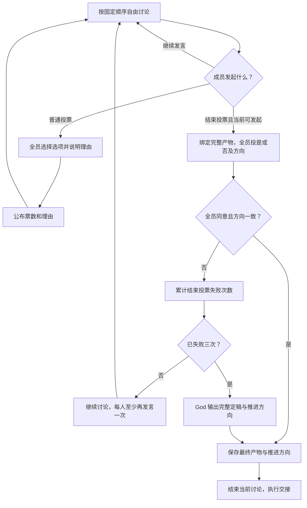

# 小组讨论、结束投票与 God 最终仲裁改进计划

日期：2026-10-31（Asia/Shanghai）  
状态：已接入显式版本的新讨论协议，旧检查点沿用原协议；验收参见对应代码与测试。  
适用范围：Exploration Group、Critic Group、Boss Group，以及它们的阶段交接、God 仲裁、状态持久化和工作台展示。

## 1. 目标与设计依据

小组通过自由讨论形成方案；成员可以自行提出议题和选项进行普通投票，也可以发起结束投票。只有结束投票全票通过，或者第三次结束投票失败后由 God 定稿，才能结束本次讨论并执行阶段交接。

God 是当前讨论的最终定稿者。它输出完整最终产物和明确推进方向，可以采用、修改、合并原方案，也可以提出新方案。God 定稿后直接落实，不回原组复议、投票或重新总结。

本文件以用户 2026-10-31 的最新要求为准，替代此前相关方案中的以下设定：

- 不采用“多数票即可结束讨论”。结束投票必须全部同意。
- 不采用“固定讨论两轮后交 God”。God 的讨论仲裁触发条件是本次讨论累计三次结束投票失败。
- 不采用“God 只能选择已有候选”。God 可以直接产生新方案。
- 不采用“Critic 只能交给 Implementation”。Critic 可以交给 Implementation，也可以交回 Exploration。
- 不采用“God 安排原组修改，再回来讨论”的收束方式。

与旧文档冲突的讨论与仲裁规定，以本文件为后续实现依据。旧文档和真实运行记录保留为历史，不据此改写既有实验的状态或结果。

### 1.1 用户已经确定的规则

1. 简化小组和 Boss 的输出字段，减少程序对科研判断的限制。
2. God 单独输出推进方向；可选方向由当前角色和业务流程提供有限选项。
3. 普通讨论中任意成员可以发起普通投票，自拟问题和选项。全体成员输出选项及理由，之后继续讨论。
4. 任意成员可以发起结束投票。全体成员只输出是／否，以及需要时的推进方向，不要求理由。
5. 结束投票必须全票通过才能推进；失败后冻结一轮发起结束投票的权限。
6. 冻结后至少每人再发言一次，才可再次发起结束投票。
7. 同一次讨论累计三次结束投票失败，立即由 God 最终仲裁。

### 1.2 本文补齐的执行约定

以下约定用于消除实现歧义，属于本计划的建议落地口径，不是旧实现已经具备的能力：

- 多方向小组必须全员选择同一推进方向，结束投票才算通过。
- 结束投票针对发起时绑定的一份完整产物，不能在投票中途改稿。
- 三次失败是累计次数，不因普通投票、修改方案或进入下一轮发言而重置。
- “冻结一轮”按失败后全体成员各完成一次普通讨论发言计数，不按墙钟时间，也不把投票算作发言。
- 同组同一时间只有一个进行中的投票；不同小组可以并行。
- 模型或网络故障不伪装成反对票，不计入三次结束投票失败。

## 2. 总体流程



全局暂停、停止和总截止时间继续生效。它们是用户的运行控制，不属于科研讨论或投票。

## 3. 普通讨论与普通投票

### 3.1 发言顺序

- 延续已经确定的调度方式：每次新讨论开始时随机生成一次成员顺序，后续轮次重复该顺序。
- 普通发言只需表达观点、问题、论据和方案。允许完整修改自己的方案，不要求维护问题编号或状态表。
- 只有当前轮到的成员发起新投票，所有成员轮到时都有相同权利；不设置专门主持人或只有某个成员能结束讨论的规则。
- 投票插入当前讨论，不重排成员。投票结束后，从发起人的下一位成员继续普通讨论。
- 未发起结束投票时，不因讨论轮数、内容哈希不变或措辞相似而自动仲裁。

### 3.2 普通投票

发起人提供问题和选项内容，程序生成投票标识、选项标识及上下文绑定。选项可以是研究方案、方法选择、参数取舍或其他讨论议题，不要求选项对应某个成员的候选方案。

```json
{
  "question": "如何处理重复文本对评估的影响？",
  "options": ["使用分组交叉验证", "保留普通划分并增加重复样本对照"]
}
```

投票期间，全体成员（包括发起人）各投一次。每张票只需包含选择和理由：

```json
{
  "option": "使用分组交叉验证",
  "reason": "同一文本不会跨训练折和验证折，更适合比较泛化能力。"
}
```

程序只统计并公布各选项票数、成员选择和理由。普通投票是讨论材料，不自动结束讨论、不自动切换阶段，也不把多数意见变成不可修改的程序规则。平票、全票、分票均返回讨论。

普通投票没有额外的次数配额。投票中的问题和选项保持稳定；有新议题可在回到讨论后再次发起。

## 4. 结束投票

### 4.1 发起与完整产物

任意成员认为当前方向已经一致且存在完整方案时，可以在自己的普通发言回合发起结束投票。发起人同时给出或选择本次准备交付的完整产物。

程序将该产物绑定到这一次投票，向所有成员展示相同内容和可选推进方向。方案可以直接来自本次发言，也可以通过可选对象引用此前完整方案；编号、版本和哈希由程序管理。

“完整且足以推进”由成员判断，不另加模型审查员或程序启发式预检查。程序只确保确实有一份可读取的产物，以及实际交接必须的数据能够解析；不猜测代码是否可运行、不要求运行前已有结果，也不限制科研结果必须是 JSON。

结束投票的内容不需要额外的自拟问题或选项：它固定询问“是否同意以这份产物结束当前讨论并推进”。

### 4.2 投票输出

全体成员，包括发起人，都必须投票。多方向小组的票只有两个决策字段：

```json
{
  "approve": true,
  "next_step": "implementation"
}
```

- `approve`：是／否。
- `next_step`：从本次上下文提供的有限方向中选择。多方向小组的每张票都填写，包括否票；只有全员同意时才用方向一致性判断是否通过。
- 只有一个方向的小组省略 `next_step`，由程序补齐。
- 提示词明确要求仅输出是／否及必要方向，不输出理由、问题清单、支持证据或系统编号。解析器容忍意外附带的说明：忽略它，不参与通过判定，也不因此拒绝整张票。
- 这张票同意的是本次绑定的完整产物，不能附带另一份修改稿作为隐含条件。

### 4.3 通过条件

一次结束投票通过，当且仅当：

1. 本次登记的全部成员都提交了有效票。
2. 所有票均为“是”。
3. 多方向小组的所有票选择同一个有效方向；单方向小组直接使用固定方向。

不使用过半规则，不允许发起人、主持人或 God 代填成员票。单成员小组也投一张自己的结束票，不额外调用其他成员来凑数。

全员同意但方向不同，属于未形成完整共识，本次结束投票失败。它不会被拆成“方案通过、方向再投一次”，也不会用多数方向强行推进。

投票通过后，直接保存被投票的那份产物和共同方向，再执行交接；不再调用总结模型重新生成产物。即使历史讨论中出现过 `must_fix` 或反对意见，也不另设旧意见否决条件。

### 4.4 失败、冻结一轮与累计次数

- 收齐全员票后，只要有人投否，或全员投是但方向不一致，失败次数增加一。
- 第一次、第二次失败后，全组暂时不能发起结束投票，但继续正常讨论，也可以发起普通投票。
- 失败后，从下一位普通发言成员开始计数；每位成员都至少完成一次新的普通讨论发言后，冻结结束。
- 冻结期间的普通投票及投票理由不计入上述发言次数。失败前的发言也不能抵扣冻结期。
- 最后一位补齐冻结期发言的成员，可以在该条完整发言之后发起结束投票；不能用一条只请求投票的空发言代替讨论。
- 第三次失败后立即进入 God，不再等待一轮、不再发起第四次结束投票，也不再回到原组讨论。
- 普通投票、方案更新、进程重启、暂停恢复都不清零失败次数。新的阶段讨论使用新的讨论实例，计数从零开始。

冻结期间误发结束投票请求时，保存本次正常发言，提示剩余未发言成员并继续讨论；不把整次模型回复判为执行失败，也不增加结束投票失败次数。

### 4.5 ABC 示例

固定发言顺序为 A → B → C。B 发起第一次结束投票，C 投否：

1. 记录失败次数 1，返回普通讨论，下一个发言人为 C。
2. C 发言，A 发言，B 发言，全体各完成一次新发言，结束投票权限恢复。
3. 中间即使插入普通投票，也不能抵扣 C、A、B 的发言。
4. 第二次结束投票仍未通过，则计数为 2，并再次冻结一轮。
5. 第三次仍未通过，直接 God 定稿；不由原成员表决是否接受 God。

## 5. 推进方向与阶段交接

### 5.1 方向是独立的决策字段

推进方向使用统一字段 `next_step`，与方案正文分开。程序根据当前组提供真实可执行的选项；结束投票和 God 使用同一份方向目录，不能让模型猜内部节点名称。

普通结束投票由所有成员共同确定方向；God 仲裁由 God 独立选择方向。单方向结束票可省略字段，God 定稿则始终明确输出 `next_step`。

### 5.2 本期建议的方向目录

| 当前组 | `next_step` | 对应效果 |
|---|---|---|
| Exploration | `critic` | 将完整研究方案交给本线 Critic |
| Critic | `implementation` | 保存最终实验计划，交给本线 Implementation |
| Critic | `exploration` | 将当前修订意见、设计选择和已有方案交给本线 Exploration，开始新的修订讨论 |
| Boss | `dispatch` | 根据明确任务安排继续研究、补充证据或调整研究方向，可以涉及多条研究线 |
| Boss | `finish_lines` | 结束明确选中的研究线，保留已有结果 |
| Boss | `finish_project` | 结束项目并按已有业务流程封存成果 |
| Boss | `report` | 交 Paper 生成报告；不因为生成报告就默认结束研究 |

这是路由能力目录，不是要求每个 Agent 填写全部分支。路由关联的载荷按需要出现：转 Implementation 要有实验计划，转 Exploration 要有可据此修订的任务内容，Boss 分派要有接收对象和任务，结束研究线要明确对象。

多种 Boss 安排需要同时落实时，`dispatch` 允许包含多个明确任务或操作，例如继续 A 线、结束 B 线并安排报告。不能由于顶层只能选择一个方向，就强迫 Boss 把合理的组合决定拆成多轮讨论。每项实际操作只保留执行所需的目标和参数，程序不从模糊正文中猜是否结束任务或重置研究方向。

Boss 组合操作采用一个扁平的 `operations` 列表，先明确以下四类操作：

| `operation` | 必要内容 | 程序效果 |
|---|---|---|
| `research` | 目标研究线；首次分派时的任务目标 | 沿当前研究方向工作。已有未完成任务时复用该任务，不重复创建周期；提供的新说明交给后续适用步骤，不偷偷修改正在运行的冻结实验。无活动任务时创建本方向的首个或下一个周期。 |
| `change_direction` | 目标研究线、新研究目标 | 明确结束旧方向的活动任务；确认旧执行已停止后建立新方向及新的 Exploration 讨论，保留旧成果。 |
| `finish_line` | 目标研究线 | 结束该线当前科研活动，保留历史；不额外派发新科研任务。 |
| `report` | 无额外必填参数 | 用当前已提交的成果和本次决定生成报告，不等待本次新安排的实验完成；新任务只能作为计划或待办写入报告。 |

例如，Boss 的完整产物可以包含：

```json
{
  "content_markdown": "继续研究线 A 的对照实验，结束研究线 B，并整理现阶段报告。",
  "operations": [
    {"operation": "research", "target": "研究线 A", "objective": "补充重复文本分组后的对照实验"},
    {"operation": "finish_line", "target": "研究线 B"},
    {"operation": "report"}
  ]
}
```

`target` 是从程序提供的研究线目录中作出的选择，实际标识由程序绑定。`finish_lines` 顶层方向只需提供选中对象，程序展开为 `finish_line` 操作；`report` 展开为报告操作；`finish_project` 是单独的项目结束效果，不同时启动新的科研操作。无需模型为这些快捷方向重复填写完整操作列表。

同一研究线的完全重复操作由程序去重；同一批次同时要求它继续、换方向或结束，属于实际操作参数冲突，需要当前产物作者明确意图。该检查在绑定结束投票产物前完成，保留正常发言、不计作一次结束投票失败；God 产物中的同类冲突在 God 当前调用中纠正，不交回原组。它不检查科学方案是否合理，也不引入问题分类或审批步骤。

整份操作计划先持久化，再按明确顺序派发；每项效果分别记录，重试只补未完成项。报告读取的快照必须标明哪些安排尚未完成。某项执行失败如实展示，不把其他已完成操作重新执行一遍，也不把“安排已接受”显示成“实验已完成”。

### 5.3 阶段串行与合法回交

- 当前讨论没有最终产物和方向前，不启动它的后继阶段。
- Critic 选择 Exploration 是合法的下一步，不是重新打开已经结束的旧讨论。
- 回交时创建新的 Exploration 讨论实例，携带 Critic 的完整交接内容及必要原始上下文。旧实例及其结束票／God 裁决不可被改写。
- 新 Exploration 完成后再交 Critic；此前结束投票的失败次数不跨讨论实例累计。
- God 的终局性适用于当前讨论，不等于禁止后续阶段根据新任务、新事实继续修订。
- 不增加跨阶段往返次数限制；运行仍受用户停止和项目总截止时间控制。

## 6. God 最终仲裁

### 6.1 输入与触发

本方案中的讨论仲裁，只由第三次结束投票失败触发。程序提供当前任务、全部成员讨论、普通投票结果、三次结束投票及其绑定方案、已有证据和本次合法推进方向。

God 能读取完整材料，摘要仅用于导航；不能因为只传短摘要就让它丢失成员实际分歧。模型、工具与证据读取失败属于技术恢复，不冒充三次结束投票失败。

### 6.2 最小输出

```json
{
  "next_step": "implementation",
  "final_output": {
    "content_markdown": "完整实验计划，以及采用这些设计的必要说明。"
  }
}
```

- `next_step` 决定交给谁或执行哪类后续动作，必须来自本次提供的方向目录。
- `final_output` 是完整阶段交付物；按路由携带真正需要的业务内容，格式与小组结束投票通过时的产物一致。
- God 可以直接修改或重新组织方案，不需要 `selected_candidate_id`。
- 决策理由可以写入正文，不强制另填 `rationale`、`minority_views` 或逐条问题处置表。
- 身份、讨论编号、版本、哈希、失败计数、来源和截止时间均由程序绑定。

### 6.3 落实方式

God 定稿后，保存产物与方向，结束当前讨论，直接执行对应交接。取消原组复议、成员再投票、主持人再总结、必须消除全部旧问题标记等后置条件。

若 God 选择 Critic → Exploration，执行一次新的 Exploration 阶段；这已经是裁决指定的下一步，不是让原 Critic 小组重新表决 God 是否正确。

格式损坏、连接失败或响应截断在 God 当前位置进行技术恢复；已有可复用回复不重复生成。恢复失败明确展示技术故障，不重新开启组内争论。God 不能凭空创造缺失的文件或真实实验结果，无法执行时要报告实际缺失条件。

## 7. 输出字段简化

### 7.1 小组的最小交互

建议普通讨论以 `content_markdown` 为基本输出，通过轻量工具发起投票。工具只是明确意图和携带数据，不新增一套科研审批程序。

| 场景 | 模型必须表达的内容 |
|---|---|
| 普通发言 | `content_markdown` |
| 发起普通投票 | `question`、`options` |
| 普通投票 | `option`、`reason` |
| 发起结束投票 | `final_output`，或选择已有完整产物由程序绑定 |
| 结束投票 | `approve`；多方向组另有 `next_step` |
| God 定稿 | `next_step`、`final_output` |

投票问题和可选项由成员决定；投票编号、选项编号、发起人、票的归属和方案版本由程序生成。成员选择某个选项或研究线属于实质决策，不要求手写或复制内部系统标识。

所有模型输出提取所需字段、容忍额外字段。选择不存在的选项时只纠正当前票，不删除该成员其他内容，也不把它当作反对票。

### 7.2 删除的旧约束

从新的讨论流程中移除：

- `ready_for_vote`：成员不需要先全员声明准备好，才能发起投票。
- 用于判断讨论进展的 `new_evidence`、候选哈希比较、无进展指纹。
- `Issue` 状态协议：`issue_id`、`category`、`resolved`、`resolution`、`experiment_mapping`、`reclassification`、`acceptance_stage`、`stage_review` 等不再作为讨论的必填管理字段。
- `must_fix` 或实验分歧对投票、定稿和交接的自动否决。
- 总结模型必须复制 `selected_candidate_id`、完整重写已通过方案的步骤。
- God 必须选已有候选、限制为原角色修订、修订后交回原组审查的讨论仲裁机制。

问题描述、风险、分歧和依据仍可写在正文或可选清单中。历史 `issues` 保留供阅读，但不能使新的讨论重新受到旧阻断规则约束。

最终计划需要验证什么，由最终计划表达；Verify 根据计划与实际结果判断。移除“成员一旦提出执行要求，就必须原样继承并逐项填写旧 `execution_checks`”的连带约束，同时保留实际运行与证据来源的可追溯记录。不能通过删除审查字段把未运行或失败的实验标成成功。

### 7.3 Boss 输出

Boss 使用同一套讨论和投票机制，不再需要专门的复杂讨论表单。

- 用 `next_step` 表达主要推进方向，避免正文、`action`、`decision` 重复表达相同决定。
- `final_output.content_markdown` 说明完整安排与依据，不再另外强制填写 `rationale`。
- 需要实际分派、换方向、结束研究线或报告时，才携带对应的最小操作参数。接收对象与任务目标不能省略为让程序猜测的自由文本。
- 原 `assign`、`continue`、`request_evidence`、`change_direction` 统一由 `dispatch` 承载；具体操作明确区分继续现有任务和开辟新方向，避免误重置周期。
- 有新共享知识时才附带内容与来源；节点编号、版本、树结构维护和写入位置由程序处理，不要求 Boss 复制内部元数据。
- 不要求每个决议都填写空任务列表、空共享记忆列表、独立报告开关或每条任务的默认优先级。确有并行报告需求时写入明确的报告操作。

业务操作参数按实际效果定义并保持精简，不以嵌套在 `final_output` 中为由，把原来全部冗余字段原样搬进去。

## 8. 程序应保存的状态与必要检查

### 8.1 程序保存，不交给模型维护

- 当前讨论实例、角色、成员、固定发言顺序和下一位发言人。
- 当前模式：讨论／普通投票／结束投票／God／已结束。
- 进行中投票的绑定产物、问题、选项和逐成员票。
- 结束投票累计失败次数，以及冻结后尚未完成普通发言的成员集合。
- 最终产物、推进方向、来源（全票通过或 God）及后续任务的投递状态。

### 8.2 只保留落实流程所需的检查

- 当前成员的票是否属于当前投票；选项和方向是否确实存在。
- 是否已收齐所有成员的票；同一成员和投票不会重复计票。
- 发起结束投票时冻结期是否结束。
- 实际要调用的后续操作是否具有必要参数和可执行接收方。
- 该讨论是否已经结束、任务是否已投递、用户是否已经停止项目。

不做“方案是否足够聪明”“修改是否有变化”“代码预估能否运行”“缺少运行结果是否应阻断”等程序推断。

### 8.3 持久化与故障恢复

保存最终产物、结束状态和待交接事件应在同一事务中完成；实际交接复用持久投递机制。重试不能重复启动 Implementation、重复写共享知识或重复结束研究线。

普通投票结果公布后、冻结期发言完成后、第三次失败后及 God 回复后，都应能从已保存状态续跑。尚未收齐票时重试缺失成员的技术调用，不用默认票补齐，不消耗业务失败次数。

中途停止保留真实已收票和已有产物，不替剩余成员投票；已停止项目不因晚到的 God 回复重新启动。

## 9. 需要明确保留的自由度与边界

1. 普通投票不预设问题类别、方案数量上限或多数结果的强制约束。
2. 不因某成员提出严重问题而赋予该意见额外程序否决权；成员可以通过结束票明确投否。
3. 不强制在设计阶段产出运行数据，也不强制实验结果转换成 JSON。这里的结构化控制消息与科研文件格式是两回事。
4. 投票和交接不跳过真实执行。启动成功、执行完成和结果有效仍分别记录。
5. 普通讨论不主动发起结束投票时，不会触发“三次失败”。本期按用户规则保留这一行为，在提示词中鼓励有完整方案后及时发起结束投票；不暗中增加轮数或时间触发的 God 机制。
6. 合法阶段回交可能反复发生。本期不新增跨阶段往返配额；如将来要限制，另行定义，不能通过重新引入 `must_fix` 等状态门槛实现。

## 10. 实施拆分与原子提交计划

以下是代码实施的工作包。每包包含对应代码、契约、迁移或兼容措施及必要测试，禁止把全部修改压成一次提交。此次实施仅修改工作区，未创建 Git 提交。

| 工作包 | 主要改动 | 验收重点 |
|---|---|---|
| A. 新交互与输出契约 | 定义普通投票、结束投票、最终产物和方向目录；精简小组与 Boss 的模型输出；系统信息由程序绑定 | 模型无需维护问题状态表、无需复制系统元数据；额外字段不使有效回复失败 |
| B. 成员发起的普通投票 | 固定顺序讨论、成员自拟议题、全员投票、结果展示后返回原讨论位置 | 普通投票不推进阶段、不改变结束投票失败计数 |
| C. 结束投票 | 绑定完整产物、全员同意与方向一致判断、一轮冻结、累计三次失败 | 任何否票或方向分歧都不能被多数票覆盖；冻结和计数可恢复 |
| D. God 直接定稿 | 新的最终产物与 `next_step` 输出；第三次失败后直接接管；撤掉旧问题与候选选择限制 | 新方案可被采用，God 后无原组复议，后继任务只投递一次 |
| E. 角色路由与 Boss 落实 | Critic 双向交接、Boss 有限方向及组合操作；同一最终产物入口处理全票与 God 两种来源 | 回交创建新阶段实例；继续／换方向／结束／报告对应正确效果 |
| F. 去掉旧阻断依赖 | 移除讨论、计划、Verify 中的旧 Issue 状态门槛及重复模型总结；更新提示词和导出 Schema | 旧问题不复活为新门禁；实际证据、实验状态与用户控制仍正确 |
| G. 展示与迁移验收 | 展示议题、票型、冻结剩余成员、失败次数、God 产物及方向；历史投影兼容 | 旧记录可读；新讨论不混用旧协议；界面与真实持久状态一致 |

### 10.1 新增前端要求（2026-10-31）

- 普通投票和结束投票必须作为聊天记录中的可读 UI 展示，不能只存在执行轨迹或后端事件中。
- 普通投票展示议题、全部选项、各成员选择和理由，以及包含零票选项的统计；统计完成后明确显示继续讨论。
- 结束投票展示绑定产物、成员是／否票和必要推进方向、通过或失败结果、累计失败次数，以及冻结期尚需发言的成员。
- 第三次失败和 God 定稿展示明确状态、最终产物及推进方向。产物可以在聊天中展开查看。
- 发起、逐票收集、结果与冻结状态分别保存为不可变消息；分页、搜索和按事件序号回放不能泄露未来收到的票或最终结果。
- 历史旧票型保留原义，不伪装成新版结束票；中止或技术故障时如实展示已收票，不能补造剩余票。

新增模式先按版本区分，未接通全部路径前不默认切换正在运行的讨论。工作包按依赖顺序启用，避免出现输出已改变而下游仍只接受旧格式的中间状态。

### 10.2 主要落点

- `packages/contracts/research.py`、`packages/contracts/schemas/`：新的最小交互格式及角色产物，移除旧问题管理门槛。
- `packages/prompts/roles.py`：自由讨论、两类投票、结束票无需理由、God 完整定稿与方向选择。
- `backend/graphs/discussion.py`：讨论／两类投票／冻结／God 的状态流转。
- `backend/graphs/arbitration.py`：讨论定稿与技术恢复分开，沿用必要的持久化和停止控制。
- `backend/graphs/engine.py`：Critic 双向交接、Boss 路由、取消对已完成产物的再次模型定稿。
- `backend/persistence/store.py`、`arbitration_store.py`、相关恢复模块：投票、计数、最终产物及交接的持久一致性。
- `backend/runtime/evidence.py`：移除与旧 Issue 编号绑定的机械验收依赖，保留真实来源记录。
- `apps/api/`、`apps/web/src/`：两类投票和明确推进方向的可读展示。

## 11. 验收场景

| 场景 | 预期行为 |
|---|---|
| 任意成员提出普通投票，选项不对应原候选 | 所有成员投选项和理由，公布结果后继续讨论 |
| 普通投票全票同意 | 仍继续讨论，不隐式结束 |
| ABC 结束票为是、是、否 | 不通过，失败数加一，冻结一轮 |
| ABC 均投是，方向为 implementation、implementation、exploration | 不通过，不能以多数方向推进 |
| ABC 均投是且方向一致 | 保存本次被投票的完整产物，直接交接，不再调用总结模型 |
| 冻结期间插入普通投票 | 普通投票不抵扣每人一次普通发言的要求 |
| 冻结期间有成员提前请求结束票 | 保留其正常发言，提示剩余成员；不启动新结束票、不计失败 |
| 修改方案或暂停重启 | 累计失败数不清零；投票进行中继续使用原绑定版本 |
| 第三次结束投票失败 | 立即 God；没有第四次结束票，也没有额外冻结轮 |
| God 提出全新方案 | 直接保存并交接，不要求属于原候选、不要求原成员同意 |
| Critic 的 God 选择 exploration | 当前 Critic 结束，新 Exploration 实例接收裁决内容；旧讨论不重开 |
| God 定稿后保存成功、交接前崩溃 | 重启复用最终产物，只交接一次，不重新讨论或仲裁 |
| 成员调用失败导致尚缺一张票 | 保留已收票并进行技术恢复，不擅自当作否票或增加失败数 |
| 历史存在未解决 must_fix | 仅作为历史意见展示，不否决新的全票通过或 God 定稿 |
| Boss 需要继续一条线、结束另一条线并报告 | 一个完整决定可以表达并落实，无须为格式限制重复开会 |
| 用户停止后收到晚到的票或 God 回复 | 保留可保存的历史记录，不启动任何后继科研任务 |

另以 Disaster-Tweets5／6 已保存的争议材料做离线场景回放，检查是否能形成阶段产物和合法方向；离线回放不等于正式实验成功，不恢复或改写原来已经停止的研究。

## 12. 历史兼容与文档维护

- 旧讨论、旧票型、旧 God 动作按原样展示，不伪造成新协议的结束投票。
- 新协议使用明确的讨论版本；旧检查点与新状态不能按字段相似度混合续跑。
- 如需迁移尚未完成的旧讨论，将原消息和产物作为输入，显式建立新讨论实例并记录迁移关系；不自动重启已停止项目，不追溯生成虚构结束票。
- 稳定落地后同步更新 `design.md`、`god.md`、`technical-implementation.md` 和使用说明，注明本方案取代的旧规则。
- `.gitignore` 仅为本实施文档开放跟踪，其他未跟踪运行记录继续忽略；既有已跟踪设计文档照常维护，不顺带加入整个 `docs` 下的实验材料。
