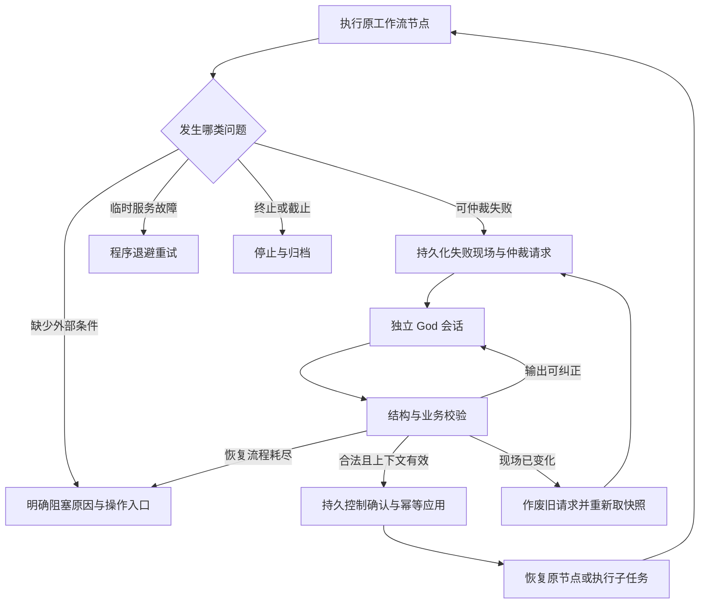

# God 自动仲裁与恢复：设计及实现方案

2026-10-31 实施更新：新协议的讨论仲裁以 [小组讨论与 God 最终定稿](./GROUP-DISCUSSION-AND-GOD-REDESIGN.md) 为准，只有累计第三次结束投票失败才进入讨论定稿。God 输出完整 `final_output` 和独立 `next_step`，直接执行，无原组复议或候选限制；格式及连接故障在当前位置恢复，不补成员票、不消耗结束投票失败次数。本文件的旧讨论触发及动作协议保留供历史检查点使用，其他技术恢复规则仍适用。

日期：2026-10-29

版本：1.0

状态：设计方案，尚未实现。文中的“新增”“应当”均指目标行为，不代表当前程序已具备该能力。

适用范围：AutoResearch 中的组内决策僵局，以及本文列出的模型输出、任务分派和设计／实现冲突。

## 1. 目标与已确定的决策

God 是组外的最终仲裁角色。工作流在检测到可仲裁的阻塞条件时自动调用 God，提供冻结的讨论及任务上下文，验证并执行其处理结果，然后继续研究。

用户不需要充当研究团队的主持人，也不需要根据一个没有操作入口的 `task.blocked` 提示自行解决平票、修改 JSON 或重新分派研究线。

本方案采用以下决策：

1. God 不属于任何 Group，不参加成员评分、发言轮转或投票，不占用成员名额。
2. Boss、Exploration、Critic 等所有使用组讨论流程的 Group 共用同一仲裁机制。未来新增 Group 也应接入该机制。
3. 调用由程序触发，不通过成员主动发送消息或调用“请求 God”工具触发。
4. 每一问对应独立的 God 调用、会话、执行身份和上下文。不同 Group 可以同时请求，不设置一个让 God 逐项处理的专用串行队列。
5. 并发仍服从模型运行器和项目已有的并发限制。容量不足时可以等待空闲槽位，但不能因为共享一个 God 会话而强制串行。
6. God 的决策经过程序校验及持久化后才产生效果。God 的输出不是数据库写入指令，也不是控制服务的授权。
7. 仲裁成功不是多数票通过。系统保留真实票型，并明确记录 `decision_source=god`。
8. 同一输入的有效仲裁结果可以恢复、复用，不因页面刷新、网络断开或 Worker 重启而重复裁决或重复执行。
9. God 既处理选择上的僵局，也处理规定范围内的失败修复。输出过长必须有子任务执行与汇总机制，不能只增加一次模型调用。
10. 用户的立即终止、共享截止时间、冻结实验约束、证据真实性和控制确认规则继续生效。

## 2. 当前实现及问题来源

以下描述以本方案编写时的代码为基线，而不是以旧设计文档推断行为。

### 2.1 严格多数与平票阻塞

`packages/contracts/research.py::majority()` 的通过票数为：

```python
threshold = len(members) // 2 + 1
```

`backend/graphs/discussion.py::collect()` 在所有成员完成投票后统计票数：

1. 有严格多数：进入主持人总结。
2. 首次没有严格多数：设置 `focused=True`，回到审查、聚焦讨论，再投票。
3. 聚焦后再次没有严格多数：抛出 `decision_blocked`。

两人组需要两人投给同一候选；1∶1 无法通过。三人各投一人、五人投成 2∶2∶1，也属于没有严格多数。

本次实际案例中，Boss 两位成员连续两轮各投自己，同时在理由中承认两份方案的可执行条款基本等价。程序按候选成员 ID 计票，不会把两份语义相近的方案自动合并，因此仍然平票。这种情况应自动仲裁。

### 2.2 统一阻塞出口过于粗糙

`backend/runtime/worker.py::execute()` 捕获异常后，会结束失败任务、将研究线或项目标记为阻塞，并发出 `task.blocked`。对于没有研究线归属的非通信任务，项目可能直接变为 `blocked`。

`ResearchEngine.guard()` 又会拒绝在 `blocked` 项目中开始模型任务。因此，“先标记项目 blocked，再正常调用 God”不能成立，God 自己也会被门禁挡住。

现有重试入口主要将失败任务重新置为 `pending`。如果检查点、候选和规则没有改变，恢复后仍会执行同一个失败节点，并再次阻塞。

目标行为是：在工作流内部识别可仲裁失败，进入仲裁及恢复流程；只有该流程无法产生合法的下一步动作时，才进入最终的 `task.blocked`。

### 2.3 当前相关文件

| 现有文件 | 与本方案有关的职责 |
|---|---|
| `backend/graphs/discussion.py` | 组内发言、审查、投票、主持人总结、讨论检查点 |
| `backend/graphs/engine.py` | 模型回合、格式修复、输出额度重试、Boss 分派、设计与实现验证 |
| `backend/runtime/worker.py` | 任务执行、阻塞出口、重启恢复、控制确认恢复 |
| `backend/adapters/dsh.py` | 会话身份、每会话锁、模型并发限制、进程登记和取消 |
| `backend/adapters/gateway.py` | 工具权限、流式消息、能力绑定 |
| `backend/persistence/store.py` | 业务对象、事件、消息、任务和持久控制确认 |
| `packages/contracts/research.py` | 角色、投票、候选、实验计划和输出合同 |
| `packages/prompts/roles.py` | 角色提示词 |
| `backend/adapters/token_limits.py` | 当前模型输出额度及截断错误 |

## 3. 自动升级范围

平票加上已经讨论的六类失败，共七种场景；其中两种使用同一个 `design_deadlock` 错误码。因此不能仅凭错误码区分恢复动作，必须同时携带来源节点及任务上下文。

| 场景 | 当前真正发生阻塞的条件 | 升级时机 | God 的处理范围 |
|---|---|---|---|
| 投票僵局 | 聚焦讨论后的投票仍没有严格多数；`decision_blocked` | 代替原抛错分支直接进入仲裁 | 选定合法候选，或明确要求补充证据、修订方案 |
| 审查无进展 | 审查状态指纹重复，仍不能进入投票；`design_deadlock` | 重复指纹被确认时 | 判断真正分歧，给出可执行的修订、取证、验证或收束动作 |
| 设计／实现循环冲突 | 相同越界修改签名再次出现，进入实际抛错分支；`design_deadlock` | 现有共同修订流程没有取得进展时 | 要求按原计划实现，或发起带版本的计划修订 |
| 主持人决议不符 | 选定候选或 Boss 决议与真实选择不一致；`invalid_group_decision` | 总结结果校验失败时 | 修复总结；业务决策原样绑定已经选中的候选 |
| Boss 分派不合法 | 初始分派漏线，或提交中出现未知、重复研究线；`invalid_boss_assignment` | 分派校验失败、业务效果尚未提交时 | 生成覆盖要求完整且身份合法的分派 |
| 重复无效输出 | 普通格式纠正后再次出现相同校验错误；`invalid_output` | 原回合修复策略将要退出时 | 修复输出、重写任务指令或安排有边界的任务修订 |
| 输出持续截断 | 已提升至 131,072 token 仍截断；`model_output_truncated` | 原额度重试策略耗尽时 | 制定拆分计划，由程序执行子任务、合并并校验结果 |

当前审查指纹包含候选内容、问题的分类／解决／实验映射状态，以及审查者的 `ready_for_vote`、`new_evidence`。它不是完整讨论文本的哈希。God 应收到真实讨论内容，而不只收到“指纹重复”一句话。

设计／实现冲突已有“返回设计修订”和“封存已有运行”的正常分支。只在当前实现确实将要抛出僵局错误时升级，不能将所有配置差异都当成仲裁请求。

### 3.1 不自动交给 God 的情况

| 类型 | 例子 | 程序处理 |
|---|---|---|
| 用户控制 | 暂停、终止、截止时间到达、方向已结束 | 保持对应控制状态，不启动 God 绕过控制 |
| 临时模型服务故障 | 限流、网络失败、部分服务端错误 | 沿用退避重试，遵守研究截止时间 |
| 状态未知 | 原 Agent 可能仍存活、实验是否启动尚未确认 | 先核查进程及运行身份、完成对账，禁止重复启动 |
| 持久确认未完成 | Boss 决议、报告或记忆仍待控制确认 | 恢复确认和业务投影，不让模型“认定已成功” |
| 外部条件缺失 | 密钥失效、余额不足、必需数据不可访问 | 给出明确原因及对应操作入口 |
| 运行环境故障 | SDK、Control、Runner 不可用 | 运行组件诊断及恢复 |

资源正常排队、实验没有提升、有效负结果、Verify 不通过，本身不是 God 仲裁触发条件。保留现有等待、修复、送验和报告流程。

## 4. 架构与调用位置

新增 `ArbitrationService`，统一负责请求去重、上下文冻结、调用 God、验证结果和提交处理动作。Group 与普通研究节点都调用该服务，不各自实现一套 God 逻辑。



### 4.1 Group 内部接入

在讨论图中增加 `arbitrate` 和 `apply_resolution` 节点，并保留原有节点名称：

- `collect` 的第二次无多数分支返回仲裁原因，不再直接抛出 `decision_blocked`。
- `collect` 的审查无进展分支进入同一入口。
- `synthesize` 对主持人决议校验失败时进入修复仲裁。
- 讨论状态增加 `arbitration_id`、`scope_revision`、`decision_source`、`resolution` 等字段。
- 原有按 Group 加锁可以继续限制同一组的状态推进，但不能把它扩大为所有 God 请求共用的锁。

### 4.2 普通节点及模型回合接入

在失败源头创建结构化 `ArbitrationRequired`，包含错误码、来源节点、目标输出 Schema 和恢复位置。由可恢复节点包装层捕获，再调用 `ArbitrationService`。

具体包装点：

- Boss 分派验证及提交前验证。
- Implementation 冻结方案冲突处理分支。
- `ResearchEngine._turn()` 的重复输出失败和额度耗尽分支。

模型回合内部先退出原 Agent 的调用，释放 DSH 会话锁和模型槽位。包装层必须位于 `engine.turn()` 的 Agent 锁之外。不能持有原成员锁，再递归调用同一成员来修复输出。

God 模型回合使用独立的 `execute_god_turn()`，复用 DSH 进程监管与合同验证，但不递归进入普通回合的 God 升级策略。

### 4.3 Worker 的职责

正常可仲裁失败应在工作流内被消费，不能先执行以下操作：

```python
store.finish_task(task_id, error=...)
store.update_project(research_id, status="blocked", ...)
```

直接等待 God 判决时，原任务保持 `running`，通过 `execution_phase=arbitrating` 表示进展。God 决定创建修订、取证或拆分子任务时，父任务改为新增状态 `waiting_recovery`，保存等待节点和恢复令牌后挂起，不能继续占用 Worker 的执行名额。研究线可显示 `phase=arbitrating`／`waiting_subtasks`，项目仍保持 `running`。其他研究线可以继续工作。

采用 LangGraph 可恢复中断保存父图等待位置，图包装层将中断规范化为 `TaskSuspended(root_task_id, graph_thread_id, resume_token)`。调用方必须逐层传递这一受控挂起结果，不能把它当成普通角色输出或成功结果。Worker 识别后退出本次执行协程、释放执行名额，但不调用 `finish_task()`。恢复时用匹配的令牌和结构化 `RecoveryOutcome` 继续等待节点，而不是从头运行。

挂起必须释放 Group／Boss 等调用栈持有的锁。同一讨论的即时修订优先走本图的状态回边；需要子任务时先挂起，再由子任务进入原组，禁止持锁递归调用同一 `GroupDiscussionGraph.run()`。普通子任务与 God 调用都不占用已挂起父任务的名额。

任务扫描、完成判定、恢复和工作台必须认识 `waiting_recovery`。存在此类任务时不能将项目判为全部完成，也不能把未满足等待条件的父任务作为普通 `pending` 任务反复执行。

Worker 对未被接入点消费的 `ArbitrationRequired` 使用可恢复任务入口处理：保存恢复标记，重新进入指定图节点，不直接执行任意 Python 回调。普通未知异常仍进入诊断出口，不把所有异常一律转给 God。

## 5. God 身份、会话与并发

### 5.1 角色与执行身份分开

| 字段 | 目标值 |
|---|---|
| 逻辑角色 | `Role.GOD = "god"` |
| UI 逻辑节点 | `god`，单个组外节点 |
| Agent 执行身份 | `god/{arbitration_id}` |
| 对话 ID | `{research_id}:god:{arbitration_id}` |
| 逻辑任务 ID | `{arbitration_id}:judge` |
| 回合 ID | `judge:{attempt}` |
| 会话目录与 SDK session | 由上述独立 Agent 身份派生 |

不能把所有请求写成 `agent_id="god"`。现有 `DshRuntimeAdapter.ensure_session()` 会依据 Agent 身份派生会话，并对同一会话加锁；共用身份会使请求串行，还会混入其他组的历史上下文。

同一仲裁的输出修复可以复用该请求自己的会话。现场改变后产生的新请求必须有新的仲裁 ID，不能复用旧现场会话。

### 5.2 并发语义

两个组同时请求时应形成两个可同时处于模型执行中的独立请求。可以复用现有异步任务和 DSH Adapter，无需构建一个串行 God Worker。

- 不引入全局 `god_lock`，也不将所有请求挂到同一个 God 对话。
- 复用现有全局、项目模型并发门禁；God 同样计入模型调用并发。
- 默认整体可用并发为 4 时，允许多问并发；若用户将总并发设为 1，容量等待是预期结果。
- 等待 God 时，失败的原模型调用已经结束，不能继续占用模型槽位。
- 不在 SQLite 写事务、控制确认事务或全局 Boss 锁中等待模型响应。
- God 给某组作出决定后，只对该组对应的恢复点应用；其他组不需要等待。

持久化 `requested` 记录用于恢复和去重，不表示存在一个专用串行队列。恢复扫描对不同请求创建独立异步调用，仍受整体容量门禁约束。

## 6. 仲裁请求与冻结上下文

### 6.1 `ArbitrationRequest`

采用 Pydantic 严格模型，不接受模型自行构造任意字段。建议字段如下：

| 字段 | 内容 |
|---|---|
| `arbitration_id`、`schema_version`、`policy_version` | 请求及协议身份 |
| `research_id`、`source_task_id` | 所属研究和原任务 |
| `scope_kind`、`scope_id` | `discussion`、`implementation`、`boss_assignment`、`turn_output`、`decomposition` 之一及具体身份 |
| `origin_node`、`origin_checkpoint` | 来源图节点和定位用检查点引用 |
| `reason_code`、`failure_fingerprint` | 允许升级的错误及稳定失败指纹 |
| `scope_revision`、`direction_epoch`、`control_generation` | 应用时需要校验的版本与控制边界 |
| `snapshot_id`、`snapshot_hash`、`source_event_seq` | 冻结上下文的身份、内容哈希和事件边界 |
| `target_schema_name`、`target_schema_hash` | 需要返回或恢复的原合同；由程序指定 |
| `allowed_actions`、`resume_point` | 本次允许的动作与受控恢复位置 |
| `provider_config_id`、`credential_version`、`model` | 本次使用的模型配置引用；不包含密钥 |
| `recovery_chain_id` | 跨仲裁请求的同一业务恢复链，记录累计轮次及完成条件 |
| `created_at`、`judge_deadline_at` | 创建时间及本次判决阶段截止时间，后者为创建时间加 600 秒与项目截止时间的较早者 |
| `expires_at` | 业务结果的最晚有效期，默认项目截止时间；现场变化也会使结果提前失效 |

`resume_point` 是已知恢复点的枚举加参数，例如 `discussion.collect`、`discussion.synthesize`、`boss.validate_assignment`、`line.implement`、`engine.validate_output`。不能持久化闭包，也不能接受模型生成模块名、函数名或可执行代码作为恢复点。

### 6.2 必须提供的上下文

God 至少收到：

1. 用户题目、研究目标、约束、截止时间、所属研究线及当前阶段。
2. 组成员清单、候选的完整当前版本、候选差异、票数统计和原始有效投票。
3. 审查问题的原始 ID、分类、解决状态、解决依据和实验映射。
4. 造成失败的节点、原始任务、目标 Schema、校验错误及已执行过的修复动作。
5. 最近相关讨论，及其消息 ID、作者、轮次；不得只给一个脱离上下文的错误字符串。
6. 已有实验、工具执行及证据引用，区分成功、失败、未验证和缺失。
7. 现有冻结计划、版本与固定设置，以及已经执行的业务效果，避免重新执行完成的工作。
8. 本次允许的动作、需要保留的限制，以及程序期望的恢复结果。

私人意愿评分只用于发言调度，不作为科学证据。通常不需要把所有评分过程放进讨论仲裁正文；若失败恰好发生在评分回合，则仅提供该回合的必要输入及输出诊断。

### 6.3 长讨论的完整性

完整快照保存为不可变的业务记录或内容寻址产物。提示词使用必要原文、候选全文、票型、阻断项和相关讨论摘录；更早历史允许摘要，但必须保留完整原文的分页引用。

新增只读工具 `read_arbitration_context(section, offset)`，让 God 读取本次快照的讨论、候选或授权证据。返回内容带偏移、总长度和哈希，单次读取有明确分页边界，不能静默截断后冒充完整上下文。

组或研究线以外的上下文只在原任务已有权限覆盖时提供。不能因为 God 是组外角色，就让它任意读取所有项目、输入目录或其他线的原始证据。

## 7. 输出合同与动作

### 7.1 `GodDecision` 外层合同

采用以 `action` 为判别字段的联合类型。共同字段：

```json
{
  "arbitration_id": "arb-example",
  "snapshot_hash": "<由请求给出的哈希>",
  "action": "select_candidate",
  "content_markdown": "两份方案的执行约束等价，采用候选 A 继续。",
  "rationale": "说明选择依据及实际差异，不捏造投票。",
  "evidence_refs": ["message-example"],
  "limitations": [],
  "unresolved_issue_ids": [],
  "selected_candidate_id": "boss/member-01",
  "minority_views": ["保留另一位成员的原始意见。"]
}
```

每种动作只包含自己的字段，禁止用一个任意 `dict` 同时装下所有可能的业务修改。请求身份和哈希必须与现场一致，模型不能修改允许动作集合、目标 Schema 或控制身份。

### 7.2 支持的动作

| `action` | 关键载荷 | 程序应做的事 |
|---|---|---|
| `select_candidate` | 既有候选 ID、理由、异议 | 取快照中的原始候选，校验可执行性后形成 God 仲裁决议 |
| `repair_output` | 目标 Schema 哈希、修复结果、来源字段引用 | 按原 Schema 和业务约束复验，再经统一输出接受路径使用 |
| `request_revision` | 目标角色、具体修改项、允许修改的范围、验收条件 | 创建带来源和版本的修订请求，恢复到指定设计／实现／输出节点 |
| `request_evidence` | 待验证问题、已有资料引用、具体取证或实验步骤、结果需求 | 转为合法的角色任务；实验仍经过冻结计划和资源流程 |
| `decompose_task` | 子任务 DAG、每项输出合同、合并规则 | 持久化子任务并执行，程序合并及校验，详见第 12 节 |
| `finish_scope` | 结束的研究线、原因、现有结果与局限 | 经对应 Boss 决议提交路径收束方向，封存已有结果并报告 |
| `needs_external_input` | 明确缺失项、为何无法自行取得、对应操作入口 | 生成可操作的最终阻塞提示 |

允许动作随来源收窄。例如普通成员的格式修复不能结束整个项目；某条研究线的仲裁不能修改其他线。项目结束动作仅允许来自项目级 Boss 范围，并沿用正常的结束与控制确认流程。

### 7.3 输出修复与作者身份

God 修复出的内容归属于 God，保存 `repaired_for_agent_id`、原执行 ID 和来源输出，不将原失败执行改写成“原角色成功”。

特殊合同必须另行处理：

- **Vote**：God 不能代替某成员补一张赞成票。要求该成员重新输出有效投票，或形成明确的 God 仲裁决议。
- **Willingness**：修复分数标记为 God 提供的调度估计，只用于调度，不当成该成员真实表达的意愿，也不公开为科学发言。
- **Verification**：God 可以修复已有完整核查结果的纯格式；不能凭空代替 Verify 完成核验。缺少实际核查时创建 Verify 修订任务。
- **Implementation / ExperimentSpec**：仍验证计划哈希、固定设置、路径、入口、版本和截止时间；不能靠添加一个 God 来源字段跳过检查。

### 7.4 来源、合同与恢复动作的对应关系

| 来源／原合同 | 本次可用的处理动作 | 恢复位置与验收 |
|---|---|---|
| 讨论投票无多数／已有候选 | 选候选、修订、取证、收束本范围 | `discussion.apply_resolution`；检查候选和阻断项，不生成新票 |
| 审查僵局／Review | 修订、取证、选择已经满足条件的候选、收束 | `discussion.apply_resolution` 或新审查轮；保留问题迁移校验 |
| 冻结计划冲突／Implementation | 按原计划修复、正式修订计划、收束本线 | `line.implement` 或新设计版本；重新验证固定设置与哈希 |
| 总结不符／Synthesis | 修复说明、要求重新总结 | `discussion.synthesize` 的结果接受路径；业务载荷取已选候选 |
| 分派不合法／BossDecision | 修复分派、请求 Boss 修订 | `boss.validate_assignment`；覆盖、身份、版本和动作校验 |
| 反复无效输出／普通合同 | 修复输出、修订任务、拆分；取证仅在该角色有相关职责时允许 | `engine.validate_output` 或对应图节点；通过原合同和业务校验 |
| 反复无效输出／Vote | 先要求原成员重答；再次失败后程序可升级整个 discussion 的仲裁范围 | 见下述专用转移协议，不能把 GodDecision 当作 Vote 返回 |
| 反复无效输出／Willingness | 修复调度估计 | 私人评分接受路径；明确标记 God 来源，不成为成员发言 |
| 反复无效输出／Verification | 有完整核查结果时仅修格式，否则要求 Verify 完成核查 | 原验证接受路径；不存在的核验事实不能被补造 |
| 最高额度仍截断／任意长输出合同 | 拆分、修订任务或合法收束 | 对应任务的合并验收节点；不能直接返回一个拆分建议冒充原结果 |

Vote 的专用转移协议：先生成要求原成员重新投票的修订任务。若该修订仍不能产生合法 Vote，程序以同一 `recovery_chain_id` 创建 discussion 范围的新请求，提供全部候选、已存在的真实有效票、缺失／无效票及审查状态。新的原因仍是输出修复失败，不冒充“全员投票后的平票”。

统一输出接受入口必须同时校验 JSON Schema 和依赖当前候选、组成员／角色、方向及版本的业务约束。业务校验由发起节点绑定到本次冻结上下文，不能以“结构化解析成功”代替“可以计票或执行”。Vote 的 `candidate_id` 必须属于本轮真实候选且对应本组成员；只检查字符串类型或所有成员 ID 都不够。校验必须在输出写入有效讨论记录和计票之前进行。

当前实现已在 `ResearchEngine.validate_output()` 增加业务校验入口，投票节点通过 `output_validator` 绑定本轮候选和组成员；此类 `ValueError` 与格式错误一样反馈给原模型，使用新的 `:repair` 执行身份重答，相同错误再次出现则转为 `RuntimeBlocked("invalid_output", ...)`。计票仍保留实际候选集合的防御校验。God 接入时，应将耗尽普通纠错的失败及其冻结校验上下文转换为结构化恢复请求，不能只对 God 的修复结果重复 JSON Schema 校验；God 升级和其他合同的角色／版本校验接入仍属于待实现方案。

原投票节点接收的是 `ScopeResolved(arbitration_id)` 控制结果，路由到 `discussion.apply_resolution`，不把仲裁载荷写入成员的 Vote 记录。只有候选和阻断项门禁允许时，God 才能直接选择候选；否则只能安排修订、取证或合法收束。该路径明确记录“投票输出无法修复，由 God 仲裁”，不伪造缺失票。

## 8. 各场景的恢复闭环

### 8.1 投票没有严格多数

聚焦后的真实票型先落盘。God 读取所有当前候选及异议，选择合法候选或指定下一步工作。

若为 `select_candidate`，程序直接采用快照中的原始候选，不依赖 God 再复制一份长候选 JSON。生成独立的仲裁说明，并以 `decision_source=god` 返回下游。God 的选择顺序是：满足硬性约束和证据要求、能完成研究目标、在剩余时间内可执行，再比较实现复杂度和资源需求。方案确实等价时允许采用候选 ID 的稳定排序作最终消歧，并明确说明等价，不让作者归属继续阻塞流程。

不要求原成员再次投票认可 God，也不再进入同一个平票循环。原票数原样保留。

普通严格多数分支仍使用 `decision_source=majority`。现有“主持人总结必须匹配选中候选”的校验保留，但提示词应分别描述多数票决议与 God 仲裁，不能继续一律称为“多数票通过”。

### 8.2 审查没有进展

God 给出结构化下一步：采用已经满足条件的方案、要求明确修订、将实际可实验分歧映射到实验，或者收束无法继续的方向。

`must_fix` 不会因为 God 说“通过”而自动变成已解决。解决需要明确依据；问题重分类仍调用 `validate_issue_transition()` 检查理由与已有来源。

修订应增加相应的候选／计划版本或讨论轮次，保留旧记录。通过新的有效状态重新推进；不直接删除问题或清空失败历史。

### 8.3 设计与实现反复冲突

God 选择：

- 保留固定计划：给 Implementation 一个明确的修复任务，保留已执行结果，生成新的代码尝试。
- 需要改变计划：发起共同设计修订，生成新 `ExperimentSpec` 版本，更新计划哈希后再实现。
- 当前方向不可行：通过 `finish_scope` 归档实际结果与局限。

不得修改旧冻结计划的内容来“让旧代码通过”，也不得把旧运行或旧验证重新绑定到新版本。

### 8.4 主持人总结或 Boss 分派不合法

对主持人总结，程序已经知道选中了哪个候选，应向 God 提供原始选择、候选及错误字段。God 修复说明部分，业务载荷由程序按选中候选绑定。

对 Boss 分派，提供全部合法研究线、当前任务状态及具体漏项／重复项。God 返回新的 `BossDecision` 候选，验证初始覆盖、研究线身份、重复项和允许动作后，仍通过现有 Boss 提交函数生效。

### 8.5 普通输出反复校验失败

保留现有首轮格式纠正；只有相同错误重复、原逻辑将要退出时升级。God 获取原任务、失败输出、精确的字段错误、目标 Schema 和业务校验条件。

`repair_output` 的结果经新增公共方法 `accept_turn_output()` 复验、持久化、发布。该方法应复用原有校验和消息接受逻辑，避免仲裁结果从异常分支直接漏进下游。

若 God 认为原任务过大或缺必要信息，则使用修订、取证或拆分动作，而不是无限尝试同一个 JSON。

### 8.6 输出持续达到上限

保留当前额度策略：私人评分 16,384，正式任务 65,536，截断后逐步提高，最高 131,072。额度耗尽后才调用 God 拆分。

截断输出保留为中断记录，不当成完整结果；即使截断文本碰巧能解析成合法 JSON，也不直接接受。

God 本身使用正式任务额度，不套用私人评分的小额度。其输入是任务结构、目标 Schema、已完成部分引用及截断位置，输出的是较小的拆分计划，不要求它再次完整生成同一份超长结果。

## 9. 幂等、状态与业务提交

### 9.1 持久化对象

先复用 `documents` 表的类型化对象及现有事件机制，无需为首版单独部署数据库：

- `arbitration_request`：来源、快照引用、状态、租约和尝试记录。
- `arbitration_snapshot`：不可变上下文及分段清单；大正文可使用已登记产物。
- `arbitration_decision`：God 原始响应、验证后的结构化决策、来源执行及决策哈希。
- `arbitration_effect`：受控恢复动作、控制确认及应用结果。
- `recovery_chain`、`recovery_child`、恢复唤醒 outbox：跨请求的恢复预算、父子任务绑定、验收状态与幂等续跑通知。
- `decomposition_plan`、`decomposition_part`：拆分计划和每一项的结果身份。

建议在请求对象上增加按项目、状态、指纹查找的索引。快照不存 API Key、网关 capability 或授权头；沿用现有脱敏流程。

### 9.2 稳定请求身份

用规范 JSON 的 `digest()` 计算请求键：

```text
research_id + source_task_id + scope_kind + scope_id
+ scope_revision + reason_code + failure_fingerprint
+ snapshot_hash + policy_version
```

通过事务中的唯一键创建或取得请求。同一现场的多次异常、并发捕获和恢复扫描都命中同一请求。时间戳、Worker PID、重试次数和普通心跳不参与语义身份。

`snapshot_hash` 只覆盖本作用域的业务内容、依赖版本及目标合同；捕获时间、租约和全项目游标等记录元数据不参与该哈希。否则同一现场在不同时间捕获也会生成不同请求，破坏去重。原消息自身的内容与来源身份仍保留在快照中。

同一 Group 的不同修订现场可以产生新请求；不能把其所有失败永久压成同一个请求，也不能为了绕过耗尽状态而只改变随机 ID。

### 9.3 状态机

```text
requested → running → decided → applying → applied
                    ↘ retry_wait → running

requested / running / decided / applying
    → cancelled       用户终止、项目截止、方向结束
    → stale           业务现场已改变
    → needs_external_input
    → exhausted       有界修复后仍没有合法处理结果
```

`decided` 表示结果通过结构及业务校验，但尚未生效；`applied` 才表示业务动作和恢复标记已提交。状态及每次转移原因都要有事件记录。

`retry_wait` 复用原请求，不重复创建 God 业务决议。`needs_external_input` 和 `exhausted` 必须携带具体诊断及后续动作，不能只有“需要用户处理”。

上述取消、失效和失败分支同样适用于 `retry_wait`。退避时持久化 `retry_not_before`、已使用的模型回合数、租约代次和脱敏错误。重启后不能依赖丢失的内存定时器。

### 9.4 业务效果只应用一次

God 不直接写共享记忆、创建正式运行或更新验证轮次。应用器根据验证后的动作，通过现有业务提交函数产生效果。

应用操作使用稳定键：`arbitration_id + decision_hash + effect_kind`。涉及 Boss、共享记忆、报告或方向结束的效果，扩展现有 `business_operations` 与控制确认恢复机制；不另造一个绕开控制确认的写入通道。

流程至少分为：

1. 短事务校验现场并登记待应用操作。
2. 事务外取得必要的控制确认。
3. 短事务核对版本及确认，将效果、恢复标记、最终状态和完成事件提交。

收到响应但尚未提交时崩溃，应恢复同一份 `decided` 结果；效果已提交但 LangGraph 未写入下个检查点时，应依据恢复标记返回已应用结果，不能再次发起模型、分派或实验。

### 9.5 异步处理结果与父任务续跑

对于修订、取证和拆分，`applied` 只表示动作及子任务已提交，不表示子任务已经成功，也不表示原失败任务已经完成。`recovery_chain` 另外记录 `waiting_children`、`validating`、`fulfilled`、`failed` 等执行状态。

每项 `recovery_child` 固定保存父任务、等待节点、恢复令牌、恢复链、计划版本、子任务 ID、目标合同、成功条件和结果引用。子任务结束后，由对应的领域验收器验证：审查修订看候选及问题状态，实现修订看原／新计划约束，取证看实际产物与来源，拆分看完整组装合同。God 的“我已处理”不能替代验收。

通过全部必需验收后，在事务中写入唯一键为 `root_task_id + resume_token` 的恢复 outbox。分发器通过版本比较将匹配的 `waiting_recovery` 父任务置为可恢复状态；图包装层消费 `RecoveryOutcome` 继续精确的等待节点。重复通知及重复分发都不得重复唤醒或推进两次。

子任务失败或验收失败时，保留已经有效完成的部分，把结构化失败交回同一恢复链；剩余轮次允许修订或替代计划。计划被替换时递增计划版本、取消不再需要的任务，旧版本的晚到结果只归档。项目停止或目标范围结束时取消父等待及相关子任务，不产生续跑通知。部分结果不足以通过原验收时，父任务保持未完成。

## 10. 版本有效性与互不覆盖

应用决策前检查：

- 项目仍可推进，控制代次匹配，没有停止记录。
- 研究线仍在同一方向代次，目标任务未被其他流程取代。
- 候选集合、选定版本、阻断项及本次依赖的计划哈希仍与快照匹配。
- 目标恢复点的 `scope_revision` 匹配。
- 涉及共享记忆等写入时满足现有版本控制条件。

不能用整个项目文档的版本或全项目事件序号作为唯一有效性条件。其他研究线正常推进会改变它们，不应因此使本组 God 结果失效。

`origin_checkpoint` 用于定位来源，不要求它与“进入仲裁之后产生的检查点 ID”相等；真正的应用边界是业务范围的修订号和依赖哈希。

过期结果标记为 `stale` 并保留，不强行覆盖当前状态。若新现场仍需要仲裁，再以新快照创建请求。

同一共享目标的提交需要短事务或范围锁保护；模型调用期间不持有该锁。涉及冻结计划、方向或共享记忆的冲突必须重新校验，不能采用最后返回的响应直接覆盖。

## 11. 停止、暂停与重启恢复

### 11.1 立即停止

每个 God 执行继续使用 DSH Adapter 的进程登记、独立 Control 和进程树终止机制。God 的角色元数据与普通成员不同，但进程仍作为受监管 Agent 执行登记。

用户终止、截止时间到达或目标方向结束后：

- 取消该范围内进行中的 God 调用和拆分子任务。
- 不再发起新的 God 调用。
- 晚到的模型结果只归档，不应用，也不恢复任务。
- 取消等待模型槽位的请求；不等待其获得槽位后再启动。

已有获确认效果的恢复遵循现有提交语义，不能因停止抹去此前已经完成的业务事实。

### 11.2 暂停

沿用“暂停新增工作”的含义：已经开始的 God 调用可以完成并持久化，但暂停期间不启动新的模型回合、修订或子任务。需要科研推进的效果保存在 `decided`／待恢复状态，恢复项目后再次校验再应用。暂停不延长共享截止时间。

### 11.3 Worker 重启

恢复请求前，先沿用现有执行身份对账：确认旧 God 进程已退出，或终止并核验其退出。`execution_unknown` 未解决前不启动替代调用。

请求具有 `owner`、`lease_epoch`、`lease_expires_at`。租约用于防止同一请求被两个 Worker 同时认领，不能单凭租约过期就认定旧进程已退出。

恢复扫描分别处理：

- `requested`：重新认领并异步执行。
- `retry_wait`：读取持久化重试时间与剩余判决时间；未到时间继续等待，到时且未暂停则重新认领。已停止则取消，已过判决时限则 `exhausted`，不能因为重启重置计数或延长时限。
- `running`：先对账；已存在完整、合法响应时恢复验证，否则创建新的执行尝试。
- `decided`：不再问 God，继续应用。
- `applying`：查询现有业务操作和控制回执，补齐投影。
- `applied`：将已应用恢复标记交回父图，推进检查点。
- 已过期或已停止：转为相应终态，只归档。

恢复扫描同时修复 `waiting_recovery`：重放已验收的恢复 outbox，检查仍在运行的子任务，补做未完成的验收。扫描不能把所有等待父任务直接设为 `pending`。如果结果已经在判决时限内进入 `decided`，之后只按业务有效期和现场版本决定是否应用，不因为判决阶段的 600 秒已经过去就重新问 God。

同一请求的新执行尝试拥有新的尝试身份；只有当前租约代次的结果可以成为最终决策，旧尝试晚到不能抢占。

## 12. 输出过长的拆分执行机制

### 12.1 拆分计划必须可执行

`decompose_task` 至少包含：

| 字段 | 约束 |
|---|---|
| `target_schema_hash` | 必须匹配原目标合同 |
| `parts` | 有界的子任务列表，每项有稳定 ID、目标角色、输入引用、输出 Schema 和允许写入的位置 |
| `depends_on` | 明确依赖关系，必须无环 |
| `merge_plan` | 程序支持的合并策略和顺序，不能是任意代码 |
| `invariants` | 原任务的固定设置、证据及版本要求 |
| `acceptance_checks` | 完整性、结构和业务验收条件 |

首版每个计划最多 8 项子任务，最大依赖深度 3，不允许子任务无限递归拆分；确需进一步拆分时在同一范围的恢复轮次内生成替代计划。子任务并发仍使用现有模型门禁。

### 12.2 执行与合并

1. 程序验证计划、持久化依赖图和各部分的幂等身份。
2. 将就绪子任务提交给 Worker 的有限任务图；新增受支持的 `decomposition_part` 任务类型和注册入口。
3. 每项复用既有角色调用、停止控制、输出验证和证据机制，不获得额外权限。
4. 父任务进入 `waiting_recovery`，显示阶段为 `waiting_subtasks`，按第 4.3 节挂起并释放 Worker 执行名额、模型槽位及调用栈的组锁，不将子任务“开始运行”误认为父任务完成。
5. 程序读取已验证的子任务结果，按已支持规则组装。
6. 组装结果通过原始完整 Schema 和原有业务校验后，才恢复原工作流。

这类有限科研子任务允许依赖调度，不等于让 God 仲裁请求进入一个专用串行队列。

### 12.3 合并规则

- 报告：按明确章节顺序组装 Markdown，保留证据引用和局限。
- 多文件实现：按相对路径合并文件；重复路径必须有明确的唯一归属或显式依赖，冲突不能静默覆盖。
- 结构化任务：按预先允许的 Schema 字段及 JSON Pointer 赋值，禁止覆盖不可修改的计划身份、控制身份和固定设置。
- 超长单文件：可以生成受控的文件片段及组装清单，程序校验顺序和内容哈希后组装；不能执行 God 生成的任意合并脚本。

最终长对象由程序从已验证部分构建，不要求某个最后的模型回合再次完整输出所有文件或全文，否则会重新遇到相同截断问题。

子任务实际生成的全部内容保留来源。组装可以归并内容，不能创建不存在的实验结果、数据值或验证结论。

任一部分失败、组装冲突或原合同验收失败，都按照第 9.5 节回到同一恢复链，不能悄悄丢弃失败部分后宣称完成。替代计划复用仍然符合新计划及版本约束的有效产物，不能复用未经验证或已过期的结果。

## 13. God 的权限、提示词与输出额度

### 13.1 权限

God 默认仅使用冻结上下文，以及 `read_arbitration_context` 中被明确授权的只读分段。它不直接运行实验、执行系统命令、任意读写文件、修改控制状态或向成员发送业务消息。

在工具网关中增加专门的 God 分支：绑定 `arbitration_id`、快照哈希及允许引用，显式限制可调用工具。不能只把 `god` 添加到普通角色白名单，因为现有部分工具按角色排除权限，简单新增角色可能意外扩大读取范围。

God 默认不依赖联网搜索，避免仲裁又被 AutoDL 的原生搜索兼容性问题阻断。需要外部证据时，由 `request_evidence` 创建授权的研究任务。

### 13.2 提示词

新增 God 系统提示词，至少说明：

- 只处理当前仲裁请求，其他会话内容不可作为事实。
- 优先消除真正的执行障碍；等价方案不应因作者归属继续争执。
- 区分事实、推断、未验证与失败；保留实际异议和局限。
- 每次返回允许动作之一，并提供依据及可执行载荷。
- 不能伪造成员投票、实验结果、验证或控制确认。
- 已经执行的工具及业务效果应复用，不主动重复。
- 上下文或证据不足时给出具体补充任务，不能只说“请用户处理”。

### 13.3 模型与配置默认值

God 首版继承项目冻结的 provider、模型和凭据版本，不另要求用户配置第二套模型。以后可增加专用模型选项，但每次请求都必须固定实际配置，恢复时不静默切换。

| 配置 | 目标默认值 | 含义 |
|---|---:|---|
| `god.enabled` | `true` | 目标版本默认启用自动升级 |
| `god.policy_version` | `1` | 仲裁与恢复规则版本 |
| God 初始输出额度 | 65,536 token | 复用正式研究任务额度 |
| God 最高输出额度 | 131,072 token | 复用当前截断提升上限 |
| `god.request_timeout_seconds` | 600 | 单个 God 请求从创建到 `decided` 的判决时限，包括模型回合修复和退避，且不得超过项目剩余时间 |
| `god.max_generation_attempts` | 3 | 同一请求的结构修复、截断重试合计最多三个模型生成回合 |
| `god.max_rounds_per_scope` | 3 | 同一恢复链累计最多三个 God 请求轮次；不是每换一个版本就重新计数 |
| 拆分计划子任务数 | 8 | 每个计划的最大部分数 |
| 拆分依赖深度 | 3 | 控制嵌套与恢复复杂度 |

网络退避受请求总时限和项目截止时间约束。God 自己输出错误时只做该请求内部的修复，不能再触发一个“更高一级 God”，也不能将无效输出直接当成仲裁结果。

这些次数是避免无进展循环的内部恢复边界，不要求用户逐项配置费用或 token 账本。额度是上限，不要求模型必须生成到上限。

600 秒不包括判决生效后执行修订、取证实验或拆分子任务的时间；这些工作继续服从项目共享截止时间。暂停不会延长正在判决请求的时限，重启也不重置 `judge_deadline_at`。已按时取得的合法判决，其待应用及子任务执行分别按业务版本和项目截止时间管理。

第一处可恢复失败创建 `recovery_chain_id`，固定关联原业务目标和恢复点。God 调用次数、修订／替代计划次数、进展指纹及验收状态跨请求持久化。改变候选版本、从 Vote 回合升级为 discussion 范围、替换拆分计划或 Worker 重启，均不能重置该恢复链的累计轮次。

此处选择明确的累计上限：一条链最多三个 God 请求轮次，每个请求最多三个生成回合；只有原恢复点验收通过或该范围合法结束，恢复链才关闭。之后其他业务目标发生的新失败可建立新链，不能仅因换了请求 ID 就当成新障碍。

范围进展指纹应包含候选、问题状态、真实新增证据、代码／计划变化及失败字段；不以时间戳、普通说明文字或随机 ID 的变化冒充进展。连续两次返回相同处理动作及载荷、原验收仍未通过时，可提前判为无进展；累计三轮仍未通过则 `exhausted`。若在额度耗尽前已有合法的收束动作，按正常流程结束对应方向。

## 14. 事件、交流记录与页面行为

### 14.1 新增事件

| 事件 | 含义 |
|---|---|
| `arbitration.requested` | 已捕获现场并创建唯一请求 |
| `arbitration.started` | God 执行开始，包含执行身份及尝试次数 |
| `arbitration.retry_wait` | 临时失败或可纠正输出，等待内部重试 |
| `arbitration.decided` | 决策已验证，尚未应用 |
| `arbitration.applied` | 效果及恢复标记已提交 |
| `arbitration.stale` | 现场改变，旧结果不再使用 |
| `arbitration.cancelled` | 停止、截止或范围结束 |
| `arbitration.needs_external_input` | 有明确缺失项，需要外部操作 |
| `arbitration.exhausted` | 规定的恢复流程耗尽 |
| `task.decomposed` / `task.reassembled` | 已创建拆分计划／通过合并验收 |

事件引用请求、原任务、范围、快照、来源序号及决策哈希，不在每条事件中重复塞入完整讨论正文。God 的流式文本、工具调用及折叠详情沿用现有记录机制，不恢复逐 token 的重复活动事件。

### 14.2 工作台

- 组织图中增加组外 God 节点，显示进行中的仲裁数量；点击后可查看独立会话列表。
- 出问题的 Group 或研究线显示“God 正在仲裁”“等待模型容量”“正在按仲裁修订”或“正在执行拆分任务”。
- 右侧记录显示 God 的实际调用与回复；工具行默认折叠参数和结果，保持当前交互。
- 原组会话中写入一条 God 仲裁摘要，包含理由、处理动作、异议和完整仲裁会话引用。
- God 身份与成员身份分开；被修复内容标记来源，不让用户误认为某成员改变了投票。
- 摘要消息直接由业务流程幂等发布，不通过普通通信消息反向唤醒成员，避免生成无意的通信任务。
- 只有 `applied` 可以显示“已采用”；`decided`、过期或取消的回复均不能显示成已生效决议。

`Workspace.tsx` 的 SSE 事件订阅、查询失效、活动标签与 `history.ts` 的回放投影必须同时覆盖新事件。历史游标在 God 决策产生之前，不得泄露后来的决议；在应用之前也不得显示后续业务效果。

### 14.3 API

新增只读接口：

```text
GET /api/research/{research_id}/arbitrations
GET /api/research/{research_id}/arbitrations/{arbitration_id}
```

列表支持范围、状态及游标过滤；详情提供快照清单、尝试历史、验证结果和已应用动作。继续遵守本机会话、项目归属、脱敏和历史游标规则。

自动仲裁不依赖前端请求。用户可继续使用暂停、终止和恢复入口，无需批准每个科研决策。终态提示若需要外部操作，必须给出具体原因、缺失对象和已有操作入口。

## 15. 现有已阻塞运行的接入

不能只改变新任务路径，还需要处理本次已经卡在 `decision_blocked` 的讨论。

实施时提供启动恢复扫描或一次性迁移入口，并满足：

1. 仅识别第 3 节范围内的阻塞；排除用户终止、截止、方向结束和控制代次不允许推进的研究。
2. 检查原讨论／任务的 LangGraph 检查点、来源错误和候选版本，冻结可恢复现场。
3. 为同一现场创建或取得唯一仲裁请求，登记恢复标记后，再将该任务恢复为可推进状态。
4. 若项目是因为这项错误整体阻塞，清理相应当前错误并恢复到 `running`；不能顺带清除其他不相关阻塞。
5. 从仲裁节点或对应恢复包装层继续，不再直接重放原来的抛错路径。

保留旧图节点名称及已有 `serial-v2` 会话／线程身份，新增状态字段均提供缺省值。不要仅把后缀改成 `serial-v3` 后从头讨论，否则旧投票、检查点和上下文被绕开，可能重复模型调用或已完成效果。

不兼容的旧检查点必须通过显式迁移器映射到新恢复入口，记录旧检查点引用与迁移事件。不能直接编辑或伪造旧投票，也不能把没有完成的旧讨论标成成功。

对已停止或过期的运行仅保存历史，不自动复活。模拟迁移可以只列出拟创建的请求和恢复点，不调用模型或修改研究；正式启用后，符合条件的运行应自动接管，不要求用户做科研内容选择。

## 16. 代码改动清单与实施顺序

下列新文件为计划新增路径，现有文件为计划修改路径。

| 文件 | 实施内容 |
|---|---|
| 新增 `backend/graphs/arbitration.py` | `ArbitrationService`、God 调用图、动作验证与恢复点分发 |
| 新增 `backend/graphs/decomposition.py` | 子任务 DAG、就绪任务调度、结果组装与原合同验收 |
| `backend/graphs/discussion.py` | 为平票、审查无进展和总结失败增加仲裁路由，保存决策来源 |
| `backend/graphs/engine.py` | 捕获其余恢复场景、统一结果接受、God 专用调用、角色修订与续跑 |
| `backend/graphs/tasks.py` | 拆分子任务的有限任务图和恢复入口 |
| `backend/runtime/worker.py` | 新任务类型、仲裁恢复扫描、在最终阻塞出口前识别恢复标记 |
| `backend/persistence/store.py` | 快照、唯一请求、状态／租约、幂等应用及控制确认恢复 |
| `backend/adapters/dsh.py` | 接受 God 独立身份，复用模型容量与进程监管 |
| `backend/adapters/gateway.py`、`packages/dsh-plugin-research/index.js` | God 的作用域只读工具及独立权限分支 |
| `packages/contracts/research.py` | `Role.GOD`、请求、判别联合决策及拆分合同 |
| `packages/contracts/schemas/` | 生成或补充对应 JSON Schema，保持合同来源一致 |
| `packages/prompts/roles.py` | God 提示词、原角色修订指令与决议来源说明 |
| `apps/api/main.py` | 仲裁查询、快照状态及恢复入口的类型化处理 |
| `apps/web/src/Workspace.tsx`、`history.ts`、交流／组织图组件 | God 状态、会话、事件订阅及时间正确的回放 |

实施分为六步：

1. **合同与存储**：实现请求、快照、决策、租约、指纹和幂等应用；先验证状态机，不调用真实模型。
2. **仲裁主链**：接入平票、审查僵局、独立 God 身份及真实 DSH 调用，完成“仲裁后继续”的最小闭环。
3. **失败修复**：接入设计／实现循环、主持人决议、Boss 分派、重复无效输出；抽取统一输出校验与接受方法。
4. **拆分执行**：实现持续截断的计划验证、子任务、组装和原合同验收。没有这一步不能宣称覆盖全部六类失败。
5. **恢复与页面**：完成崩溃、并发、停止、旧阻塞运行迁移、事件和回放；给出真实状态及来源。
6. **完整验收**：跑完第 17 节场景，使用配置好的模型进行短真实验证，再启用目标默认行为。

God 不能作为一个只返回文字建议的临时工具交付。完整实现必须能够应用合法处理结果并恢复原工作流。

## 17. 验收标准

### 17.1 功能与真实性

- 两人连续 1∶1 后自动调用 God，得到合法选定候选后下游继续；票型仍为 1∶1，来源为 God。
- 三人各投自己等无严格多数的票型也走同一机制；有严格多数时不调用 God。
- Boss、Exploration、Critic 至少分别覆盖一个僵局用例。
- 审查无进展和相同实现越界签名的失败都能生成带现场的仲裁请求。
- 非法总结和不合法分派能够修复并通过原合同校验，不修改历史有效票。
- 普通无效输出先执行原格式修复，再升级；God 修复有明确来源，不能冒充原成员投票或 Verify 核查。
- 必修问题或未知证据不会因为 God 选择了方案而自动消失；需要补证据时，生成并执行具体任务。

### 17.2 并发与防死锁

- 总模型并发至少为 2 时，两个不同 Group 的 God 调用都进入执行后，才允许其中任意一个返回；证明不是串行轮询。
- 两个请求的会话、上下文、执行身份及结果互不混用。
- 总模型并发为 1 时能正常等待和推进，不出现父调用占着唯一槽位等待 God 的死锁。
- 恢复动作再次调用原角色时不持有原成员锁；不同组仲裁不受一个全局 God 锁限制。
- 将 Worker 可执行任务容量设为 1，父任务挂起后子任务仍能取得名额、完成验收并恢复父任务；同一 Group 的修订不会因父图持锁而死锁。

### 17.3 恢复、版本与控制

- 同一现场并发触发两次，只接受一个有效决策和一组效果。
- God 返回后、写 `decided` 后、效果提交后、父图检查点更新前，分别注入崩溃，恢复后均不重复业务效果。
- 候选或方向已变化时，旧决策变为 `stale`；其他研究线普通进展不会错误地使其失效。
- God 运行中立即终止，相关进程和子任务退出；晚到响应不推进项目。
- 暂停不启动新的 God 或子任务，恢复后重新检查有效期。
- 数据库暂时不可写时，独立停止仍有效；数据库恢复后可恢复已有确认。
- 当前已阻塞的讨论能够迁移进仲裁，而不是重新开始全部讨论；已停止运行不会被复活。
- 退避期间重启、暂停或停止时，`retry_wait` 按持久化时间和计数恢复；重复唤醒 outbox 不推进父任务两次。

### 17.4 输出拆分与有限恢复

- 持续截断时自动生成多部分计划，实际执行、合并并通过原合同；不是再次整体生成超长输出。
- 检查循环依赖、重复文件路径、未授权字段覆盖、部分失败和子任务重复完成。
- 重启后复用已完成部分，不重复运行已经完成的正式实验。
- God 自身持续无效或同一范围无进展时，按规定结束恢复，不递归请求 God。
- 修订、取证、拆分的部分失败和验收失败均能返回同一恢复链；替换版本或重启不能重置累计轮次，600 秒判决时限不会错误地限制后续正式实验。
- 最终无法继续时，提示包含原始错误、已经尝试的处理、具体缺失条件和下一步操作。

### 17.5 界面和真实模型

- 工作台准确显示正在仲裁、容量等待、修订、拆分和已采用等状态。
- 工具参数和结果默认折叠，展开可见；God 决策和应用动作可追溯。
- 历史回放不提前展示 God 后来的决策或已应用效果。
- 使用当前配置的 AutoDL / DeepSeek 模型验证一次真实 God JSON 决策，以及两个并发请求；不把本地工具协议测试当作整个仲裁已通过。

## 18. 完成定义

本功能完成时，用户看到的是“系统正在自动处理这个僵局”及其实际进展，而不是一条没有处理入口的 `task.blocked`。

平票与六类规定失败都有可追踪的恢复路径；God 可以并发、可以停止、可以恢复；合法结果确实推进工作流；需要外部条件时系统能准确说明缺少什么。只有同时满足这些条件，才是完整的 God 自动仲裁实现。
