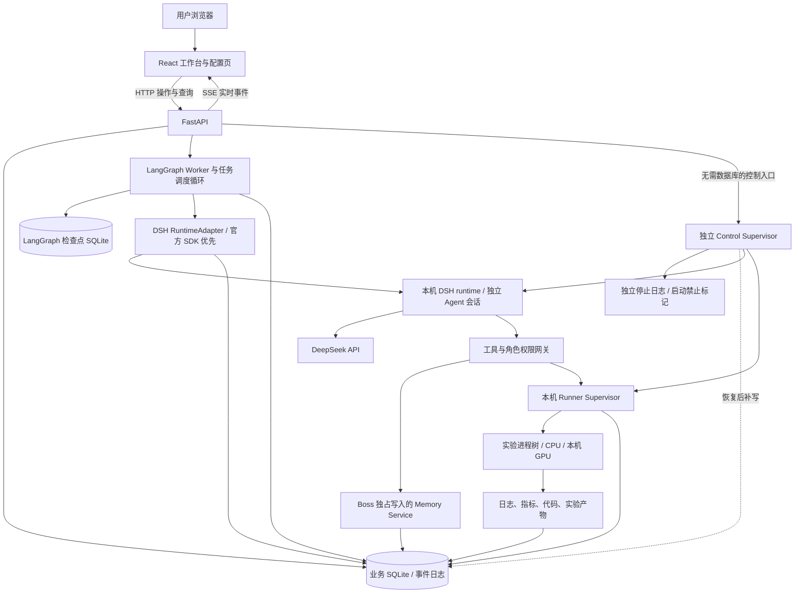
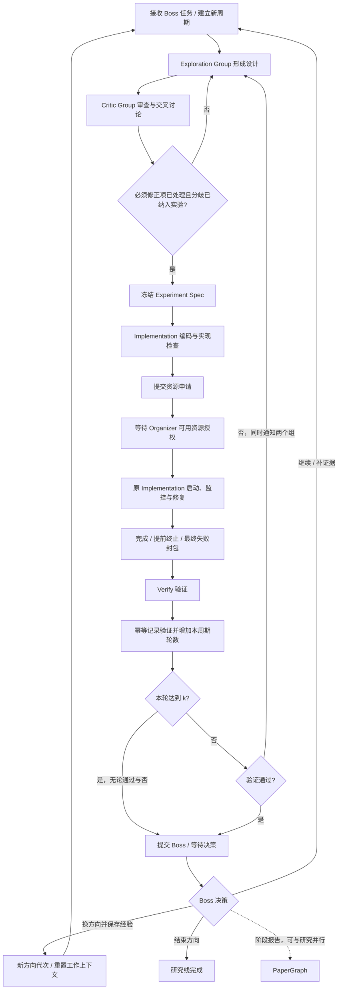
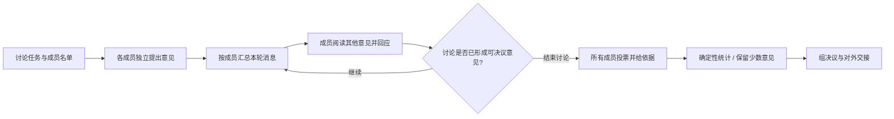

# AutoResearch 技术实现方案

2026-10-31 实施更新：新的小组讨论使用显式 `protocol_version=2` 状态与独立 `:group-v3` 实例标识，普通发言、两类投票、冻结成员集合和累计失败数持久化在 `discussion_state`。逐票及结果作为不可变 `discussion_vote` 聊天消息保存，支持分页、搜索、按事件序号回放；最终产物与待交接意图在同一事务写入。旧 `:serial-v2` 检查点仍按旧图续跑。God 直接定稿及角色路由以 [新协议](./GROUP-DISCUSSION-AND-GOD-REDESIGN.md) 为准；Boss 操作计划先持久化，逐项记录执行效果并恢复未完成项。

版本：v1.3  
日期：2026-10-25  
依据：[design.md](./design.md)  
目标：为本机运行的自动化科研系统提供可直接拆分开发任务的技术方案。

## 1. 已确定的需求与实现决策

系统由用户在网页输入研究题目，创建多条研究线。LangGraph 负责研究流程、组内讨论、角色交接和恢复；每个 Agent 使用完整 DeepSeek Harness（下文简称 DSH）执行自身任务。网页以交互流程图呈现组织与运行状态，以聊天会话呈现真实的组内、组间及 Agent 间交流。

本方案继承同步更新后的 design.md 的研究规则。以下需求已经由用户确认：

- Boss Group 默认 3 人，允许在高级配置中调整。
- 首版服务与实验均运行在本机，不以远程 GPU 机器或云服务为前提。
- 人类可以随时立即终止研究，包括正在运行的正式实验、轻量计算、Agent 与工具任务；不等待本轮研究自然结束。
- 研究预算仅保留一个总运行时间设置。移除模型 token/费用、CPU/GPU 秒、轻量计算、分实验等配额及重试次数配置，不实现分项预算账本。

### 1.1 技术决策摘要

| 方面 | 首版选择 | 目的 |
|---|---|---|
| 前端 | React + TypeScript + Vite | 实现题目输入、工作台、配置与历史页面 |
| 交互流程图 | React Flow（`@xyflow/react`）+ ELK 布局 | 展开 Group、选择 Agent、点击连线查看交接 |
| 后端接口 | Python 3.12 + FastAPI + Pydantic | HTTP 接口、输入校验、事件订阅 |
| 流程编排 | LangGraph Python | 显式状态机、条件路由、组内并行、检查点 |
| Agent 执行 | 优先官方 Python SDK + 打包 DSH runtime，项目提供 RuntimeAdapter | M0 比较事件、权限、恢复覆盖，仅为缺口补建 Bridge/插件 |
| 默认模型 | DeepSeek V4.1 Flash，API 模型 ID 为 `deepseek-flash` | 全部角色默认使用同一模型 |
| 实时推送 | SSE；操作命令使用 HTTP | 浏览器实时观察、断线续传、历史回放 |
| 数据 | SQLite WAL + 本地文件产物 | 降低单机部署成本，保留完整证据链 |
| LangGraph 检查点 | `AsyncSqliteSaver`，独立检查点库 | 研究线与讨论任务恢复 |
| 实验进程 | 本机 Runner Supervisor | 进程树管理、监控、终止、重启后对账 |
| 紧急运行控制 | 独立 Control Supervisor + 本地停止日志 | 数据库不可写时仍能禁止启动、结束进程；数据库恢复后补写 |
| 密钥 | 后端凭据服务，Windows Credential Manager/DPAPI | API Key 不进入前端持久存储与 Agent 上下文 |

React Flow 支持通过 `parentId` 表达父子节点，适合 Group 与成员的展开视图；布局与运行状态映射由本项目实现。[React Flow 官方文档](https://reactflow.dev/learn/layouting/sub-flows)

DeepSeek 官方文档在核对时将 `deepseek-flash` 映射到 DeepSeek-V4.1-Flash-1017。UI 显示用户熟悉的“DeepSeek V4.1 Flash”，请求使用实际 API ID，并记录调用时返回的模型信息。该别名可能继续更新，不将别名当作不可变模型版本。[DeepSeek 模型说明](https://api-docs.deepseek.com/quick_start/pricing/)

### 1.2 首版范围

首版必须形成完整链路：输入题目 → Boss 分派研究线 → Exploration / Critic 讨论 → Implementation 实现 → Organizer 安排本机资源 → Implementation 启动与监控 → Verify → Boss 决策与共享记忆 → 阶段报告。

同时交付可操作的团队与密钥配置、所有角色的交流记录、可点击流程图、持久化、断线续传与故障恢复。完整聊天与运行追踪属于首版能力，不推迟到后续版本。

首版按单用户、单机部署设计；多次研究可以存在，但共享一个机器级资源调度器。暂不实现多人协同编辑、跨机器调度、自动投稿和最终论文流水线。外部模型与文献检索仍可能联网，“本机部署”不等于离线推理。

## 2. 不可改变的业务约束

下列约束必须通过状态机、服务校验和工具权限落实，不能只写进角色提示词。

| 约束 | 实现位置 |
|---|---|
| 每条研究线固定绑定自己的 Exploration、Critic、Implementation、Verify | 拓扑生成器与角色注册表 |
| 第 k 次完成 Verify 后，无论结果如何只交 Boss | `commit_verification` 事务与确定性路由 |
| k 之前通过即交 Boss，未通过同时返回 Exploration / Critic | 同一事务生成目的地及交接消息 |
| Implementation 不自行改变研究固定项 | 版本化 Spec、配置差异校验、越界修订路由 |
| Organizer 批准即具备可启动资源，并返回原 Implementation | 资源预留、原子启动准入与回收互斥；无 Agent 认领接口 |
| 正常流程中完成、提前终止、正式执行失败都提交 Verify；人类终止/到期后仅封存待验证 | 统一封包节点与优先级更高的停止状态 |
| Verify 不复跑正式实验，仅可在研究截止前进行轻量 CPU 分析 | Verify 工具权限与统一截止时间 |
| 只有 Boss Group 维护共享记忆 | Memory Service 写权限与 Boss 决策凭证 |
| 放弃方向只重置工作上下文，保留历史证据 | `direction_epoch` 与追加存储 |
| Paper 报告可以和继续研究并行 | 独立报告图与冻结的输入快照 |
| 实验没有提升不等于执行失败，也不等于验证未通过 | 分离运行状态、科学观察与验证状态 |
| 人类立即终止与总时间到期优先于全部 Agent、审批和等待点 | 不依赖业务库的停止闩锁、独立控制通道、进程树终止与停止记录补写 |
| 所有研究线共用一个总截止时间，不因暂停或重启重置 | `started_at + max_runtime_seconds = deadline_at` |

## 3. 本机系统架构



### 3.1 进程划分

1. **API 进程**：提供同源网页、配置、查询、控制与 SSE；不在请求生命周期内运行研究。
2. **编排 Worker 进程**：首版仅一个实例，内部用异步任务推进不同 LangGraph thread；持有机器级调度所有权。
3. **DSH runtime 进程**：由 Worker 通过 RuntimeAdapter 持有，优先使用官方 Python SDK 管理其打包运行时；只有 SDK 无法覆盖且经 M0 证明需要时才引入自建 Host。运行时采用按需、有界的实例池，不为每个逻辑 Agent 常驻一个进程。并发受模型信号量、session 锁及已验证的 SDK 实例并发能力共同限制。
4. **Runner Supervisor 进程**：长期管理实验子进程、日志与心跳；API 或 Worker 重启不应直接终止已启动实验。
5. **Control Supervisor 进程**：由本地启动器独立管理，持有项目停止闩锁、控制代次、已登记任务/进程索引和停止日志；通过独立 IPC 向 Runner、runtime 监督器发出停止。其命令与状态接口不调用业务数据库，也不复用 Worker 或数据库写入队列。

本地启动器先启动 Control Supervisor 与停止入口，再启动 API 的业务功能、Worker 与独立 Runner，负责检查依赖、管理端口和优雅退出；业务库连接/迁移失败不能使停止入口无法服务。DSH runtime 的生命周期由 Worker 经适配层管理，并向控制服务登记。首版在 Windows 原生环境运行；实验需要的 Python 环境、CUDA 或其他依赖按题目配置并预检，不能假定本机一定有 GPU。

业务 SQLite 使用 WAL、短事务和有界写入队列。检查点库与业务库分离，因此两者之间不存在天然的原子提交，恢复机制必须按第 12 节设计。日志大文件不进入数据库。

### 3.2 LangGraph 与 DSH 的职责边界

| LangGraph / 业务服务 | DSH |
|---|---|
| 决定谁在何时执行、下一步交给谁 | 执行一个 Agent 的具体任务 |
| 维护研究线、轮次、讨论阶段和等待条件 | 模型调用、工具调用、会话与上下文管理 |
| 检查角色权限、研究截止时间、消息路由 | 在授予的工具范围内查询、编码、分析 |
| 保存流程检查点与业务交接结果 | 保存单 Agent 会话及 Harness 执行记录 |
| 将通信与执行事件转换为统一数据协议 | 提供真实消息、工具过程、完成/异常事件 |

不能把每个 Agent 替换成一次裸模型调用后仍声称实现了完整 DSH。也不能让 DSH 的自主协作能力绕过 LangGraph 创建未登记角色、直接发起正式实验或修改共享记忆。完整 Harness 的能力由角色策略限制，这与 design.md 的工具权限约定一致。

## 4. 团队配置与运行身份

### 4.1 规模参数

| 参数 | 含义 | 默认值 | 校验与说明 |
|---|---|---:|---|
| `n` | 并行研究线数量 | 2 | 正整数；首版 UI 上限建议 16 |
| `m1` | 每条线 Exploration Group 人数 | 2 | 正整数；首版 UI 上限建议 8 |
| `m2` | 每条线 Critic Group 人数 | 2 | 正整数；首版 UI 上限建议 8 |
| `k` | 每条线向 Boss 强制汇报的 Verify 周期 | 3 | 正整数；首版 UI 上限建议 20 |
| `boss_members` | 全局 Boss Group 人数 | 3 | 用户已确认默认值；高级配置，建议上限 9 |

除 Boss 默认人数外，上述默认值和 UI 上限是本方案建议的工程初值，不是 design.md 已经规定的研究策略。配置页必须允许用户修改 n、m1、m2、k，显示解释和拓扑预览。

每条线另有 1 个 Implementation Agent、1 个 Verify Agent。全局另有 1 个 Experiment Organizer、1 个 Paper Agent。

```text
逻辑 Agent 总数 = n × (m1 + m2 + 2) + boss_members + 2
默认配置 = 2 × (2 + 2 + 2) + 3 + 2 = 17
```

Agent 总数不等于同时进行的模型请求数，也不等于实验并发数。默认模型并发建议为 4，正式实验并发建议为 1；后者还受本机资源约束。配置页展示三个独立指标，避免把增加成员误解为增加物理算力。

### 4.2 身份与版本

- `research_id`：用户输入一次题目产生的研究项目。
- `line_id`：项目内固定研究线身份，例如 `line-01`。
- `group_id`：Exploration、Critic、Boss 的稳定身份。
- `agent_id`：成员身份，例如 `line-01/exploration/member-02`。
- `direction_epoch`：方向代次；Boss 换方向时递增。
- `cycle_id`：Boss 每次正式下发新研究任务产生的新周期。
- `submission_id`、`submission_version`：一次送验包及其不可变版本。
- `experiment_run_id`：一次正式进程运行；同一计划可以有多次运行。
- `execution_id`：某个 Agent 的一次任务执行；重试增加 `attempt`。
- `conversation_id`、`message_id`：聊天会话与消息的独立身份。
- `event_id`、`seq`：事件唯一身份及项目内递增序号。

`agent_id` 与 DSH session ID 分离。一个成员可有不同方向代次的会话，但前端仍能在同一角色位置查询旧方向历史。项目角色的 session key 至少包含 `(research_id, agent_id, direction_epoch, profile_version)`，不同项目中同名的成员不能共享会话。机器级 Organizer 是唯一的例外，使用 `(machine_id, organizer, profile_version)` 的显式共享会话，仅处理各项目带身份的资源请求与排期；其消息和执行记录仍分别关联请求所属项目。项目拓扑中的 Organizer 节点是对该机器级角色的引用。

配置在创建研究时冻结为 `config_snapshot`，同时记录模型、提示词、工具策略、图结构和依赖版本。修改设置只影响新研究。运行中更换失效凭据可显式重新绑定凭据版本并记录事件；n、m1、m2、k 不在运行途中热改。

总运行时间也随配置冻结。持久化 `max_runtime_seconds`、首次启动时间 `started_at`、`deadline_at`、`stop_reason`、`stop_requested_at` 与 `control_generation`。所有研究线共享这些项目级字段；改变研究方向、创建新 Verify 周期、暂停或重启均不重置截止时间。总时间的计算与到期动作见 §8.4。

## 5. LangGraph 编排设计

### 5.1 图的分层与独立推进

采用“多个独立持久化图 + 可靠消息投递”的方式组织项目。每条线是独立的 LangGraph thread，避免某条线的实验或讨论阻塞所有其他研究线。

| 图 | 作用 | thread 标识示例 |
|---|---|---|
| `ResearchSupervisorGraph` | 初始化题目、请求 Boss 初始分工、登记研究线、项目结束协调 | `research/{research_id}/supervisor` |
| `ResearchLineGraph` | 一条研究线从设计到 Verify 与等待 Boss 的主循环 | `research/{research_id}/line/{line_id}/{direction_epoch}` |
| `GroupDiscussionGraph` | 一次组内多轮讨论、互评、投票与汇总 | 作为调用方的子图，讨论任务有独立 ID |
| `BossDecisionGraph` | 审议提交、决策、记忆更新、新任务与报告任务 | `research/{research_id}/boss/{decision_task_id}` |
| `OrganizerGraph` | 评估资源申请、提出排期/分配决策 | `machine/organizer/{scheduling_task_id}` |
| `PaperGraph` | 基于冻结证据快照编写阶段报告 | `research/{research_id}/report/{report_id}` |

Supervisor 通过事务写入启动命令与任务表，Worker 为各条线分别调度图执行；Supervisor 不以一次 `Send` 扇出整个长期研究流程后等待全部汇合。`Send` 用于一个有限讨论轮内的成员并行，轮结束后再汇总。这样跨线是异步推进，组内某个讨论阶段可以有明确的同步点。

LangGraph 提供 `StateGraph`、`Send` 和 `Command`，分别用于图状态、动态并行和状态更新/路由。本项目在这些原语之上实现研究规则。[Graph API 官方文档](https://docs.langchain.com/oss/python/langgraph/graph-api)

### 5.2 单条研究线的业务流程



图中从 Verify 退回 Exploration 的箭头表示重新进入共同修订流程，实际交接记录同时投递给本线 Exploration 与 Critic。第 k 轮不会生成该退回消息。

实现问题与资源变化是显式分支：实现内修复留在 Implementation；计划越界请求回研究组；追加资源返回 Organizer。正常流程中的正式实验若停止或最终失败，保留记录并完成封包/送验。图上任意阶段都允许被人类终止或总时间到期抢占；这种情况下取消整个研究的在途任务，仅程序化封包并标记待验证，不再调用 Verify/Boss/Paper。尚未完成合法 Verify 不增加轮数。

### 5.3 ResearchLineState

图状态只保存推进流程所需的小量信息与稳定引用，不保存完整文件、所有聊天内容或 API Key。

```python
class ResearchLineState(TypedDict):
    research_id: str
    line_id: str
    direction_epoch: int
    cycle_id: str
    task_id: str
    phase: str
    config_snapshot_id: str
    completed_verify_rounds: int
    k: int
    active_spec_id: str | None
    active_spec_version: int | None
    active_submission_id: str | None
    active_submission_version: int | None
    active_run_ids: list[str]
    pending_command_ids: list[str]
    wait_token: str | None
    last_applied_transition_id: str | None
    memory_snapshot_version: int
    conversation_refs: dict[str, str]
    error_ref: str | None
```

单线状态由该线图串行修改。讨论子图的并行结果使用按 `agent_id` 合并的 reducer；重复执行结果用 `(discussion_id, phase, round, agent_id, attempt)` 去重。不把多个并行成员的消息直接追加到无幂等保护的共享列表中。

组内子图采用每次调用隔离的检查点作用域，成员长期上下文存于各自 DSH session。不要并发调用同一个有累积状态的子图实例共享检查点命名空间。官方文档区分每次调用与每个 thread 的子图持久化语义；本方案据此将讨论任务状态和成员长期会话分开。[LangGraph 子图文档](https://docs.langchain.com/oss/python/langgraph/use-subgraphs)

### 5.4 Verify 轮次与路由

`completed_verify_rounds` 初始为 0。完成第一个正式送验包的验证时计为第 1 轮。仅在形成有效、结构化的 Verify 报告并取得 §12.2 的有效提交确认后增加计数，模型超时或格式错误不算完成验证。确认与停止的先后以控制服务内的串行顺序判定，数据库延迟补录不会形成一次新的验证。

下面是业务伪代码，数据库事务与约束必须真实实现：

```python
def commit_verification(cycle_id, submission_version_id, report, execution_generation):
    if not control.allows_progress(cycle_id):  # 独立停止闩锁；失联默认拒绝
        archive_late_report_without_round_or_dispatch(report)
        return {"route": "halted"}
    with transaction():
        existing = find_verification(cycle_id, submission_version_id)
        if existing and existing.is_effective:
            return existing.transition  # 重放不重复计轮、发消息

        cycle = load_current_cycle_for_update(cycle_id)
        project = load_project_in_same_transaction(cycle.research_id)
        if (project.is_terminating_or_terminal
                or now() >= project.deadline_at
                or execution_generation != project.control_generation):
            archive_late_report_without_round_or_dispatch(report)
            return {"route": "halted"}
        assert cycle.is_active and cycle.state == "verifying"
        assert report.matches_plan_code_and_runs()
        assert 0 <= cycle.completed_verify_rounds < cycle.k

        round_no = cycle.completed_verify_rounds + 1
        if round_no >= cycle.k:
            route = "boss"
            reason = "periodic_report"
        elif report.passed:
            route = "boss"
            reason = "verification_passed"
        else:
            route = "exploration_and_critic"
            reason = "revision_required"

        operation = stage_verification_idempotently(
            cycle_id, submission_version_id, report, round_no, route, reason,
            status="pending_control_confirmation",
        )  # 只存候选；不计轮、不改有效周期、不派发

    # 已退出数据库事务。确认和停止在控制服务内串行；此处等待不持有控制锁。
    receipt = control.confirm(operation.id, operation.content_hash)
    if receipt is None:  # 已停止/到期/失联：仅保留历史，绝不绕过确认
        return {"route": "halted"}
    if not persist_confirmation_receipt(receipt):
        return {"route": "awaiting_confirmation_sync"}

    with transaction():
        transition = apply_confirmed_verification_once(operation.id, receipt)
        append_outbox_once(operation.id, transition)  # 派发仍过独立停止门禁
    return transition
```

在 SQLite 中以上更新用短写事务及条件更新实现，不依赖不支持的行级 `SELECT FOR UPDATE` 语义。`load_current_cycle_for_update` 是业务名称，具体实现使用 `BEGIN IMMEDIATE` 或等价的单写者串行化与版本校验。

唯一约束为 `(cycle_id, submission_version_id)`，候选结果重放复用同一 operation ID。`apply_confirmed_verification_once` 核验回执与候选内容哈希、周期版本，原子更新计数及有效状态；停止前已确认的完整报告可在恢复时补录为历史完成，停止后未确认的报告只能归档。所有 outbox 消费另查独立控制状态，历史补录不能重新唤醒研究。`pending_control_confirmation` 不能当作已完成 Verify，也不能出现在有效计轮投影中。图恢复后先取得有效 transition，再对齐状态。通过不改写历史失败；到达 k 也不把 `passed=false` 改成 true。

Boss 只有正式下发“继续/补证据/新方向”的新任务时才建立新 `cycle_id`、把计数置 0。仅接收材料、更新记忆或要求 Paper 写报告不会清零。送验后修订产生新的不可变版本，再完成一次 Verify 才进入下一轮。

### 5.5 等待、唤醒与并发保护

等待 Organizer、Boss、外部工具结果时使用持久化等待点；可用 LangGraph `interrupt()` 与 `Command(resume=...)` 表达，不占用循环轮询的 Agent token。`interrupt` 是程序等待机制，不意味着所有等待都需要用户审批。[LangGraph Interrupts 文档](https://docs.langchain.com/oss/python/langgraph/interrupts)

每个等待点持有 `wait_token` 和预期事件类型。业务 inbox 先持久化再唤醒：

1. 收到事件时校验 `research_id / line_id / cycle_id / wait_token`。
2. 图尚未进入等待点，事件留在 inbox；进入等待后重新检查，防止先到消息丢失。
3. 同一 thread 同时只允许一个执行者持有有效 lease；迟到旧结果不恢复新周期。
4. 消费成功记录 inbox 状态；重放相同事件返回相同 transition。
5. `interrupt` 所在节点可能从头执行，等待之前的副作用必须幂等，不能裸写“先启动实验，再 interrupt”。

## 6. Group 讨论、投票与真实通信

### 6.1 通信对象

消息端点可以是 Agent 或 Group。Group 发言必须包含真实汇总者 `authored_by_agent_id` 与其依据的讨论决议，不用虚构发言代表全体成员。

会话分为：

| 会话类型 | 示例 | 保存内容 |
|---|---|---|
| Group 内部讨论 | Exploration_1 组内会话 | 每名成员的提案、回复、投票、异议、总结 |
| 组间讨论 | Exploration_1 ↔ Critic_1 | 方案版本、质疑、回应、修订与未解决分歧 |
| 任务交接 | Critic_1 → Implementation_1 | 冻结方案、边界、附件及接收确认 |
| 资源协调 | Implementation_1 ↔ Organizer | 申请、排队原因、资源授权、结束通知 |
| 验证讨论 | Implementation_1 ↔ Verify_1 | 提交说明、已有证据补充、验证报告 |
| Boss 审议 | Boss 组内与 Boss ↔ 研究线 | 成员讨论、决策依据、新任务 |
| 报告任务 | Boss ↔ Paper | 报告范围、冻结资料、报告产物 |

用户能观察以上所有会话，也能按一个 Agent 聚合查看其参与的全部会话。用户观察权限不等于其他 Agent 获得所有会话的上下文读取权限。跨研究线知识默认通过 Boss 与共享记忆传播；如以后允许直接跨线交流，也必须通过同一网关登记，不能产生不可见的旁路。

### 6.2 GroupDiscussionGraph



一个讨论轮的输入快照先固定，再通过 `Send` 并行执行成员任务；各成员读取截至该轮开始的完整相关发言，下一轮读取本轮新增内容。组内成员不是彼此不知情地独立生成几段答案后立即总结，必须至少包含“独立意见 → 阅读并回应 → 决议”三个阶段。

不再配置组内讨论轮数或方案往返次数配额。成员根据论据是否充分推进到投票；出现无法解决的设计僵局时明确上报，不靠无限生成填满时间。每轮保存实际执行成员和缺席/失败状态，技术重试不冒充成员意见。研究到期或人类终止时可从任何讨论阶段直接退出，不强行补完投票。

在需要主持的 Group 内，从已有成员中确定一个轮值主持人，不增加未计入团队人数的隐藏 Agent。主持人负责提炼候选结论、整理发言与输出决议；投票统计及流程门槛由程序执行，主持人不能伪造其他成员的票。

### 6.3 决议规则

- 一般方案选择：有效成员按预设多数规则选择；采用严格多数 `floor(member_count / 2) + 1`。
- 成员缺席不自动视作赞成，也不临时缩小多数分母。不可恢复错误进入明确阻塞状态；可恢复错误在研究仍可运行时按退避策略重试。
- Critic 的“必须修正”项必须逐条记录 `resolved`，或经过带依据的复核正式改类；单纯多数票不能隐藏尚存阻断项。
- “可以通过实验回答”的分歧必须映射到对照、消融或反证设计，不要求先证明方法有效。
- Boss 方向与结束决议也使用预设多数规则；Boss 拥有业务决策权，但不改写 Verify 的验证事实。
- 平票安排聚焦讨论与再投票；仍无多数且没有新的可区分依据时生成 `decision_blocked`。总时间到期直接进入终止流程，不生成伪造决议。
- Exploration / Critic 的设计僵局可以单独向 Boss 上报 `design_deadlock`，不计 Verify 轮次，不冒充第 k 轮周期汇报，也不自行启动实验。
- Boss 自身无法形成决议时，暂停对应任务并在网页显示需用户处理；不能无限对话或由主持人擅自宣布结果。

### 6.4 发言与交接的执行合同

项目向 DSH 注册通信工具，例如 `send_research_message`、`publish_group_decision`。这些名称是本项目拟实现的工具，不是声称 DSH 已提供的内置 API。

每次调用经过角色、目标、当前阶段及研究未终止/未到期校验。消息成功提交到数据库后才算发送成功，并有 `accepted / delivered / acknowledged / rejected` 投递状态；接收者消费哪一版内容可追溯。受众字段支持多个接收者，同一条 Verify 失败反馈可同时送达两个组，前端不必伪造两次发言。终止后补采的旧消息可保存为历史，但不能派生新任务。

组间的每次方案、质疑与回应都形成真实消息。只保存最终总结、把工具日志重新包装成虚构聊天，均不满足本需求。

## 7. DSH 接入与模型服务

### 7.1 官方 SDK 优先与自建适配范围

官方已经发布 `deepseek-harness-sdk`，入口类为 `deepseek_harness.DeepSeekHarness`，支持 Windows x64。安装包含匹配的原生运行时，正常 SDK 执行不依赖系统 Node.js；前端构建及外部插件管理的依赖另行区分。[官方 Python SDK 指南](https://deepseek-harness.github.io/deepseek-harness/en/guide/python-sdk)

**选型顺序：官方 SDK → SDK + 必要 profile/插件 → 有证据的缺口才自建 Bridge/Host。** 首版不预先实现另一套进程传输协议。LangGraph 只依赖本项目的 `DshRuntimeAdapter` 合同，SDK 后端优先实现该合同；有无完整事件覆盖、可执行的角色策略和恢复保证，须以 M0 结果决定，不能仅凭存在 SDK 就判定全部需求已满足。

官方 SDK 已提供 runtime 生命周期管理、会话恢复、通知与结果接口。`resume_session` 恢复会话历史，不恢复外部进程；结果 `events` 与实时通知对根会话/子会话的覆盖不同。普通回合需显式配置超时；项目仍保留独立 Runner 和执行账本。[官方 SDK 参考](https://github.com/deepseek-ai/deepseek-harness/blob/master/python/sdk/README.md)

M0 必须完成下面的覆盖比较并记录目标 SDK/runtime 版本、profile、测试证据与剩余自建范围：

| 能力 | SDK 优先验证路径 | 项目验收条件 / 未覆盖时的处理 |
|---|---|---|
| 运行与会话 | `DeepSeekHarness`、明确的 home/workspace、完整 `sdk` profile | 同一会话串行、不同角色隔离；先限制实例内并发，再测试并发安全 |
| 事件与实时聊天 | 通知回调、结果事件、持久会话日志 | 验证文本增量、工具、子会话、结束/错误、顺序和补采；缺失部分补事件插件 |
| 权限与凭据 | profile/patch、工具策略、SDK 客户端审批能力 | 角色权限由服务确定性判断；覆盖 shell/文件旁路与 Key 脱敏；不把每次调用改成人工审批 |
| 恢复与幂等 | 持久 session 恢复、runtime 关闭/异常行为 | 验证 Worker 崩溃、断管道、旧进程退出、会话占用；不足时补 supervisor/执行账本 |
| 取消与超时 | 锁定版本公开的取消/关闭能力与进程监督 | 人类终止或到期能取消模型并结束本机工具进程；不依赖模型响应，不能卡住 SSE；未确认退出不能报告成功 |
| 自定义科研工具 | SDK profile 加项目插件 | 通信、资源申请与记忆写入复用项目网关；只有插件无法补足的协议缺口才自建 Host |

`sdk-minimal` 只用于最小接通验证，不作为满足“完整 DSH”的生产配置。正式采用完整 `sdk` profile 并施加角色策略；仅设置 workspace 不能证明文件/进程已隔离。会话日志上报、工具 roster 和凭据流向纳入配置审查，本项目默认关闭额外的 session-log 上传。M0 必须实际验证这些策略，不能复制最小示例后视为角色权限已落实。[官方 SDK 指南](https://deepseek-harness.github.io/deepseek-harness/en/guide/python-sdk)

同步 SDK 调用放入受控执行线程/运行时实例，不能阻塞 FastAPI/LangGraph 的事件循环；未证实线程安全前，同一个 SDK 实例也串行使用，通过有界实例池支持不同 Agent 并发。运行时实例在活动期间只承载一个研究项目的任务，并登记其工具进程，确保强制停止该项目时可以结束对应进程树。机器级 Organizer 使用独立实例，每次调度任务绑定一个项目；终止项目时既撤回其排队请求，也取消当前属于该项目的 Organizer 模型/工具执行。SDK 无法细粒度取消时结束该 Organizer runtime，确认退出后再恢复共享会话处理其他项目；其他项目队列保留，不能让被终止项目的 Organizer 继续生成。

生命周期合同对两种后端一致：Worker 正常退出须关闭所持实例；Worker 崩溃、控制管道 EOF 或心跳超时后，适配层须确保旧 runtime 的在途任务被取消、持久日志可恢复并取得退出证据。SDK 是否已满足逐项实测，缺口用最小 supervisor 补齐。Worker 重启先确认旧 runtime 退出、释放会话锁，才创建替代实例；状态不明则暂停该范围调度。独立 Runner 继续管理已启动实验，监控空窗期仍执行硬限制与预设停止规则。

以下是本项目适配接口，不是官方 SDK 方法名；逐项映射到锁定版本 SDK 能力或本地账本：

| RuntimeAdapter 操作 | 含义 |
|---|---|
| `ensure_session` | 按 Agent、方向代次和 profile 建立/恢复会话 |
| `execute_turn` | 执行一次有边界的 Agent 任务，流式返回消息及工具事件 |
| `get_execution` | 查询某个 execution 是否运行/完成，防止恢复后重复调用 |
| `cancel_execution` | 请求取消模型/工具调用，等待明确结束状态 |
| `export_session` | 按本项目协议归档必要会话内容与来源索引 |
| `reset_context` | 新建方向上下文并归档旧 session，不删除证据 |

需要扩展时优先使用目标版本的插件、会话事件与工具策略扩展点，不修改 DSH 核心 Agent 循环。DSH Cordis 事件与持久化 session 事件须分开处理，API 以锁定版本类型与源码为准。

仅当 M0 证明官方 SDK/插件无法满足必需合同，才启用自建 Bridge 后端：受控进程的 JSON Lines/RPC 通道，stdout 专用于协议，stderr 用于诊断；携带 `request_id`、attempt、取消标识与产物引用。自建 Node.js Host 是可选实现，新增运行时依赖在该后端选定后才成为部署要求。

### 7.2 执行幂等与上下文

逻辑任务键 `logical_turn_key = (agent_id, task_id, turn_id)` 与执行尝试键 `execution_attempt_id` 分开。Worker 在事务中登记逻辑任务及 attempt，再向 RuntimeAdapter 的 `execute_turn` 传入这两个标识。适配层按 `execution_attempt_id` 先持久化再调用 SDK/模型，同一 attempt 的重复请求只返回原状态/结果；不假定 SDK 自带本项目的业务幂等。只有确认旧 attempt 已完成、中断或失败，且没有仍运行的同一逻辑任务后，Worker 才能在事务中生成递增的下一 attempt；SDK 或 Bridge 不自行生成新的业务重试身份。所有事件包含 attempt 与稳定来源游标，缺少原生事件 ID 时由适配层以持久日志偏移建立补采映射。

模型请求本身无法保证跨崩溃只计费一次。对于已发出但结果未知的调用，先查询 DSH 记录；无法恢复时关闭旧执行并标记 `interrupted`，再按上述规则申请新 attempt，不把两次生成拼成一条完整发言。恢复过程无法确认旧执行是否仍在工作时保持 `unknown`，不能越过此检查直接重试。

每个 DSH session 另有持久化的单写者 lease/队列，同一时刻最多执行一个 `execute_turn`，与模型全局并发限制分别生效。Boss 决策按研究项目整项排队，上一项讨论与决策提交完成后才开始下一项；Organizer 按机器串行处理有限的调度批次，等待资源的实验停留在资源队列，不占住 Organizer 会话；同一个 Paper Agent 的多份报告任务也串行处理。不同研究线的成员 session 可以并行。这样独立 LangGraph thread 不会并发污染同一 Agent 的长期上下文。

各 Agent 保持独立 session、工作目录和工具策略。共享记忆按“全局索引 → 方向摘要 → 条目 → 原始证据”读取，并记录所读版本。上下文压缩生成带来源 ID 的摘要，数据库中的原始聊天不因压缩而删除。

### 7.3 模型调用合同

默认配置：

```json
{
  "provider": "deepseek",
  "display_name": "DeepSeek V4.1 Flash",
  "base_url": "https://api.deepseek.com",
  "model_id": "deepseek-flash",
  "credential_ref": "credential/deepseek/default",
  "max_concurrent_requests": 4
}
```

调用使用 DSH 对应的模型适配器，固定支持的思考模式及接口所需参数。模型提供方固有的上下文/输出限制不作为项目自建 token 配额；请求等待时间不得越过研究截止时间。具体字段须在 M0 对当前适配器验证后写入 profile，不把未经验证的参数静默忽略。

结构化决策使用 JSON Schema/Pydantic 二次校验。字段缺失或非法枚举按错误内容请求修复；相同错误无进展时进入 `invalid_output`/阻塞，不自动走“通过”分支。不另设可配置修复次数预算，所有修复在总截止时间或人类终止时立即停止。

统一处理鉴权失败、限流、网络错误、超时和取消。401/无效凭据暂停相关任务并提示配置；可恢复网络错误在剩余总时间内指数退避重试，不配置重试次数上限，终止事件可中断退避等待。token/费用如提供方返回则作为观察数据记录，不做扣额或停机判断。模型 alias、返回的实际模型字段、调用日期与参数写入记录；未返回不可变版本时明确标为未知。

## 8. Organizer、本机实验与总运行时间

### 8.1 调度决策与资源账本

Organizer Agent 分析申请、优先级、依赖与资源需求，并输出结构化排期建议。确定性的 Resource Service 校验建议并原子预留实际资源。只有成功预留之后才发出 `allocation.granted`。

首版采用可解释的“优先级 + 等待时间增长 + 资源可容纳”策略。Organizer 可给出优先级与理由；资源服务只维护机器实际占用，防止超配与饥饿，不实现累计计算预算。不同项目共享机器资源账本，不能各自承诺使用同一块 GPU。

资源申请至少包含：计划版本与哈希、Implementation 身份、CPU 核数、内存、GPU UUID/数量/显存需求、预估时长、项目 `deadline_at`、依赖、可恢复条件。CPU/内存/GPU 数值用于放置与资源占用，不建立按秒累计消耗的扣额机制。

授权至少包含：`allocation_id`、`grant_revision`、原 `implementation_agent_id`、计划版本、资源范围、项目 `deadline_at / control_generation`、`grant_expires_at` 及资源 `fencing_token`。启动准入后保存绑定的 `experiment_run_id`、`runner_instance_id / runner_generation`、`start_operation_id` 与准入时间。实际启动代码版本另行记录，防止修复后运行了新代码却沿用旧版本说明。

```text
requested → queued → granted（资源已预留）→ starting → running
                        ↓                    ↓          ↓
                     expired             reconciling / stopping
                        ↓                    ↓
              可原子释放并重新排期        对账确认 → releasing → released
```

`queued` 表示尚未批准，`granted` 表示资源已经预留、原 Implementation 可立即请求启动。Implementation 直接调用 Runner，不增加 Agent 认领步骤。启动前的普通查询仅用于展示/预检，不能作为创建进程的授权依据。

**启动准入与授权过期必须共用资源账本上的原子状态转换。** Resource Service 提供仅供原 Implementation 经 Runner 使用的内部 `begin_start` 操作，将有效授权绑定到唯一 run 并转为 `starting`；这不是额外的 Agent 认领或 Boss 审批。

#### 8.1.1 原子启动准入

同一业务 SQLite 写事务中执行以下步骤（`BEGIN IMMEDIATE`，获取写锁后读取服务端权威时间）：

1. 在同一事务读取项目状态、截止时间与 control generation，拒绝已请求终止、已到期或代次过旧的请求；再校验授权身份、计划版本、grant revision、资源 token 及 Runner 身份，确认资源仍归该授权持有。
2. 条件更新：只有 `state = granted`、`bound_run_id IS NULL` 且 `grant_expires_at > now` 时，才写入 run/Runner/启动操作绑定，并将授权改为 `starting`。更新数必须恰好为 1。
3. 在同一事务登记 `experiment_runs.state = starting`、启动操作与事件/outbox，保持原资源占用。任何校验/写入失败全部回滚。
4. 提交后才返回启动准入回执；只有该回执对应的 Runner 能进入创建进程阶段，且仍须通过 §11.5.2 的独立启动门禁。数据库回执不能覆盖控制服务的停止闩锁。若响应丢失，同一 `(allocation_id, grant_revision, experiment_run_id, runner_generation)` 查询/重试取得原状态；其他 run 或 Runner 不得复用绑定。

数据库保证一个授权版本只能绑定一个 run，一个 run 固定绑定一个授权版本和一项启动操作；同一操作可查询/重放，但不能换操作 ID 重新启动相同 run，终结后需要新的实际运行则建立新 run。独占 GPU 等资源在全部有效占用状态下只能归属一个授权。CPU/内存等可分资源的总预留不得超过容量，分配、绑定与释放都通过同一事务入口维护。`experiment_run_id` 幂等防止同一次运行重复执行，资源所有权与上述原子转换另外保证不同实验不会拿到同一份不可共享资源。

#### 8.1.2 过期与回收互斥

过期清理使用同一数据库写事务，仅条件匹配 `state = granted AND bound_run_id IS NULL AND grant_expires_at <= now` 的授权，才将其标为 `expired` 并释放资源；未命中不释放。不能根据事务外读取的“已过期”结果执行无条件回收。

因此并发只会有两种有效顺序：启动先提交，则过期清理看见 `starting` 并跳过；过期先提交，则 `begin_start` 条件更新失败，Runner 不得创建进程。SQLite 事务不跨越耗时的操作系统进程创建，资源占用由持久化的 `starting` 状态延续保护。

进入 `starting` 后，原待启动有效期不再是直接释放依据。启动超时、取消、Runner 失联或回执丢失时进入 `reconciling / stopping`（失联可附 `suspect` 标记），仍保持资源占用。只有确认进程树已结束，或确认没有创建进程且所有旧启动操作已终结、今后也不能执行，才能在事务中释放。不能把“当前查不到 PID”当作不存在迟到启动的证明。

待启动授权有效期与启动对账超时是控制协议的时限，分别用于拒绝迟到启动、触发对账；不是独立研究预算。正式实验与所有角色直接继承同一个项目 `deadline_at`，Organizer 无权另设或延长研究时间。Worker 调度 lease 换代不撤销已绑定授权；Runner 定期报告存活与占用，失联仍保留资源并对账。人类终止或总时间到期则主动停止正在运行的实验，不再等待其计划完成。

### 8.2 Runner Supervisor

Runner 的启动由对应 Implementation 的受控工具触发。Runner 是执行进程的基础设施，不替代 Implementation 的实现、监控与排错职责。

Runner 提供项目内部 `start / status / collect / request_stop` 等操作。`start` 先完成 §8.1 的 `begin_start` 事务，再持久化启动准入回执、run/授权/token/Runner generation 的完整绑定。仅有 run ID 或先前“授权有效”的查询结果不能创建进程；Supervisor 保留进程创建时间和进程组身份，防止 Worker 重试造成重复训练。

Runner 对同一授权版本的创建、取消和回收对账采用串行临界区，并持久化取消墓碑。取消不能在一个仍可能创建进程的 `start` 操作尚未退出时回复“已清理”；如果创建已经开始，就等待结果并终止相应 Job 后再确认。取消先处理时，后到的同版启动命令由墓碑拒绝。Resource Service 取得包含 `allocation_id / grant_revision / run_id / runner_generation / start_operation_id` 的终结证明后才释放；旧 generation 的迟到成功回执不得将已释放授权重新改成 running。

停止入口不等待 `begin_start`、数据库锁、取消墓碑落盘或日志写入。Runner 先设置本地内存停止闩锁并取消待启动操作；启动临界区不得包含数据库/文件 I/O 等待，实际创建/恢复执行前复查控制 epoch、停止闩锁与启动登记。停止与已经进入创建阶段的操作按上述规则收敛到进程树退出，再报告完成。数据库不可写时保留资源隔离，不能因进程停止就绕过账本给其他实验重新分配。

Runner 重启前必须确认旧实例已退出，恢复后先读取独立停止状态，再从资源账本与本地日志加载有效绑定和取消墓碑；取得当前控制 epoch 的许可后才接受启动。控制状态、数据库或旧实例/操作状态不明时禁止启动，保持隔离占用，不给替代实验新授权。墓碑在旧 token 仍可能被重放期间保留；旧 token 永不重新赋给其他 run。

Windows 首版使用进程 Job Object 管理实验进程树和资源边界，子进程也纳入同一生命周期。GPU 默认整卡独占，通过分配 GPU 身份和环境设置约束使用；仅设置 `CUDA_VISIBLE_DEVICES` 不是完整安全隔离。任务启动前检查机器实际空闲情况并完成原子准入，发现外部进程占用时不超配启动；已进入 `starting` 的授权按上述对账/释放流程处理，不能直接改回空闲。

首版明确采用“Runner 失效则停止其管理的实验”策略：Job Object 由 Runner 独占持有，设置 `KILL_ON_JOB_CLOSE`、禁止 breakaway，不把句柄继承给实验。Worker/API 重启不会关闭 Runner 的句柄；Runner 本身崩溃则由操作系统终止所辖实验，恢复后作为中断/执行失败归档。任何不确定状态先核验进程树，禁止盲目重启。该策略优先保证不留下失控训练，不承诺 Runner 崩溃后实验仍无损运行。[Windows Job Objects](https://learn.microsoft.com/en-us/windows/win32/procthread/job-objects)

Windows 启动后端要求支持创建时加入 Job：以 §8.1 已提交的 `starting` 绑定及准入回执为前提，在 Runner 串行临界区内通过 `STARTUPINFOEX / PROC_THREAD_ATTRIBUTE_JOB_LIST` 将挂起进程在创建时关联 Job，并在内存登记可终止的 Job/进程身份；退出临界区后才持久化身份，期间停止通道仍能直接结束该 Job。持久化成功后重新进入短临界区，复查停止闩锁、control epoch 与操作状态，确认有效才恢复执行；之后在临界区外提交 running 回执。不要采用有遗留窗口的“裸创建挂起进程后再加入 Job”；能力预检不通过则阻止该后端启动，不能静默降级。任何中间失败关闭 Job、核验清理并终结该启动操作，再申请释放。running 回执丢失时资源仍处于占用状态，恢复后按实际进程对账。[Windows 进程属性接口](https://learn.microsoft.com/en-us/windows/win32/api/processthreadsapi/nf-processthreadsapi-updateprocthreadattribute)

机器级资源发现支持 CPU、物理内存、磁盘、本机可见 GPU；没有 GPU 时显示“无可用 GPU”，CPU 任务可以继续，GPU 申请保留等待/不可满足状态。若需改变实验设备或精度，会影响科学设置时必须回研究组修订。

### 8.3 监控与提前终止

Runner 采集心跳、退出码、资源消耗、stdout/stderr、指标文件和产物清单。Implementation 根据这些信号及 Spec 监控约定决定继续、修复或提前终止，不逐条日志唤醒一次 LLM。

建议心跳 5 秒，资源采样 5–10 秒；健康异常或指标观察窗口完成时安排 Implementation 分析。人类终止和项目到期直接走控制通道，不等待心跳采样或 Agent 分析。采样不得改变实验规定的评估频率。

- **直接停止**：人类终止、研究总时间到期、失去合法资源授权由 Runner/运行控制服务直接执行；记录独立原因，不等待 Implementation 认可。
- **科学判断**：是否继续具有信息价值、收敛是否异常等由 Implementation 依据计划与证据判断。
- **终止过程**：立即发停止信号并收集已经存在的产物；固定短清理宽限内未退出则强制终止进程树。不得以保存检查点为由无限等待；确认进程结束后才释放资源，具体见 §11.5。
- **执行修复**：仅在固定项不变、允许调整范围内，且研究未终止/未到期时进行。需要改变方案回研究组，需要改变资源分配回 Organizer；不因重试重置研究总时间。

实验终态包括 `completed`、`early_stopped`、`execution_failed`、`cancelled`，人类终止/到期记录 cancelled 及具体原因。科学观察另存为 `improvement / no_improvement / negative / inconclusive`；已完成的 Verify 报告另存 `passed / failed`，未完成报告使用独立 `verification_pending` 状态，不能当作 failed。三种维度不能合成一个“成功/失败”字段。

### 8.4 唯一预算：整个研究的总运行时间

配置页只提供 `max_runtime_seconds` 作为研究预算，必须为正整数，UI 可用分钟/小时输入并换算为秒。建议初值为 3600 秒，用户创建研究前可修改。不设置 token/费用、CPU 秒、GPU 秒、MiB/GiB 消耗配额、分实验/轻量计算预算，也不配置重试次数或讨论次数上限，不预留额外模型收尾额度。

**计时口径**：首次实际启动前，事务写入 `started_at` 和 `deadline_at = started_at + max_runtime_seconds`，完成后才派发第一个任务。所有 n 条研究线并行共享同一个实际经过时间；不是将各 Agent/实验时间相加。资源排队、暂停、人工等待、服务重启间隔都计入，恢复不补时，修改方向与 Verify 周期不重置。终止/到期后不允许 resume 复活；用户要继续时以已有产物创建新研究并重新设定时间。

**到期动作**：项目、Runner 与 runtime 监督器都保存同一截止时间，在本地注册可中断的截止计时器；不要只在下一次模型调用前检查。任何启动、重试、唤醒和工具调用入口检查停止标记与剩余时间；各监督器即使暂时联系不到 Worker，也到时停止自己管理的执行。重启后先检查截止时间，过期项目直接恢复终止清理，不重新启动 Agent 或实验。

**到期收尾**：立即停止所有新增与在途工作，包括正式实验、轻量计算、模型请求和工具进程；仅允许程序化进程清理、日志刷新和已有产物清单归档。未完成验证设置 `verification_pending`，不调用 Verify/Boss/Paper，不自动增加时长。进程清理可能在截止瞬间之后完成，但这不构成额外的研究时间，也不允许继续生成或实验。

Exploration、Critic、Verify 仍只使用轻量 CPU 工具入口，禁止 GPU、重新训练和正式大规模评估；Verify 只分析已有产物。工具权限、科学设置和机器资源分配保持有效。模型并发、物理 CPU/GPU 占用、授权有效期、通信/清理超时是运行机制，不做累计扣额，也不增加预算配置项。用量可以记录展示，但不要求为停止决策实现精确的 token/算力计费统计。

## 9. 数据模型与产物存储

### 9.1 核心持久化对象

| 对象/表 | 主要字段与用途 |
|---|---|
| `research_projects` | 题目、状态、配置快照、max_runtime_seconds、started_at/deadline_at、stop_reason/stop_requested_at、control_generation |
| `business_operations` | 不可变科研候选、内容哈希、原状态版本、pending_control_confirmation/applied/archived 状态与独立确认回执引用 |
| `research_lines` | 角色绑定、方向代次、当前周期、阶段 |
| `agents` / `groups` / `group_members` | 拓扑身份、角色、成员关系、DSH 会话引用 |
| `research_cycles` | Boss task、k 快照、已完成 Verify 轮数、周期状态 |
| `agent_executions` | Agent、任务、attempt、起止时间、模型使用、错误 |
| `conversations` / `messages` / `message_deliveries` | 完整交流、回复关系、受众与投递状态 |
| `discussion_rounds` / `votes` / `group_decisions` | 各轮成员意见、票据、少数意见、门槛结果 |
| `experiment_specs` | 计划版本、父版本、固定项、调整边界、监控与项目总截止时间 |
| `submissions` / `submission_items` | 送验清单、代码与运行引用、完整性校验 |
| `resource_requests` / `allocations` | 排队、授权版本/有效期、物理资源/token、项目截止时间/控制代次、绑定 run、Runner generation、启动状态 |
| `launch_operations` / `runner_tombstones` | 启动准入、创建/取消操作、终结证明、拒绝迟到启动的持久墓碑 |
| `experiment_runs` / `run_attempts` | 进程身份、实际代码/配置、修复、状态与消耗 |
| `verification_reports` | 输入版本、检查依据、结论边界、轮数、通过状态 |
| `boss_decisions` / `reports` | 决策、新任务、报告快照与产物 |
| `memory_nodes` / `memory_versions` | 树形索引、证据引用、版本与状态 |
| `artifacts` | 相对路径、媒体类型、字节数、SHA-256、生成者与用途 |
| `events` / `outbox` / `inbox` / `commands` | 事件、可靠交接、命令幂等与恢复 |
| `credentials_metadata` | 凭据引用、掩码、状态、版本；不存明文 Key |

数据库外键和唯一约束维护引用完整性。对于 SQLite，要显式启用外键约束。查询围绕 `(research_id, seq)`、`conversation_id`、`agent_id`、`line_id`、`experiment_run_id` 建索引。

### 9.2 Experiment Spec 与 Submission

Spec 版本在运行前冻结；计划调整建立新版本，代码修复建立新代码版本。每次运行都绑定实际 Spec、代码、数据版本、启动参数和资源授权。

```text
Submission manifest
├─ identity：line / direction / cycle / submission / parent / version
├─ exploration：问题、假设、文献、记忆引用、轻量验证
├─ critic：三类质疑、处置依据、保留分歧
├─ plan：固定项、允许调整、对照、数据、指标、重复/消融
├─ monitoring：信号、等待期、窗口、终止规则
├─ implementation：代码快照、环境、入口、依赖
├─ allocation：Organizer 授权、物理资源与项目总截止时间
├─ runs：全部正式运行、失败、修复、提前终止、实际消耗
├─ evidence：指标、图表、日志、模型及其他产物引用
├─ verification：绑定当前版本的验证报告
└─ cycle_history：本周期各轮记录及 Boss 汇报摘要
```

“完整提交包”指完整交代当前尝试及状态，不要求实验一定成功或一定有最终指标。正式失败包也能完整描述原因、现有证据和缺失项。

送验基础 manifest 不可变；Verify 报告、Boss 决策和 Paper 报告作为独立追加对象引用该 manifest，展示时组成完整逻辑包。不能把 Verify 报告写回被验证文件从而改变其哈希。

本地产物采用临时文件写完后原子替换并计算校验和；大文件以稳定 artifact ID 传递。代码保存可复核的 Git commit 或不可变归档及哈希，不能只保存会继续变化的工作目录路径。

### 9.3 共享记忆

Memory Service 将树的节点、版本、引用关系存数据库，并可导出为 design.md 中的 `memory/` 目录结构。Boss 的记忆更新包含 `decision_id`、来源提交、状态、适用条件和原始贡献者。

只允许持有有效 Boss 决策上下文的请求写记忆。Boss Group 成员可以讨论候选更新，但最终由一次已提交决议触发原子写入。其他角色只能读取或提交建议，Paper 也无写权限。

同一研究项目的 Boss 决策与记忆写入串行提交，用 `base_memory_version` 比较并更新；版本冲突时重新读取、合并并保留冲突来源。默认记忆范围是该研究项目，跨项目复用需要后续显式导入，避免题目之间意外混用未验证结论。

## 10. 统一事件协议与聊天记录

### 10.1 持久化消息

消息正文独立保存，不等同于前端临时 token 流。最小消息对象如下：

```json
{
  "message_id": "msg-0123",
  "research_id": "research-001",
  "conversation_id": "line-01/exploration-critic/epoch-1",
  "sender": {"type": "agent", "id": "line-01/critic/member-01"},
  "recipients": [{"type": "group", "id": "line-01/exploration"}],
  "authored_by_agent_id": "line-01/critic/member-01",
  "reply_to_message_id": "msg-0118",
  "discussion_round": 2,
  "cycle_id": "cycle-003",
  "kind": "critique",
  "content_markdown": "该对照仍缺少相同训练步数，请补充设置一致的基线。",
  "artifact_refs": ["artifact-plan-v2"],
  "status": "complete",
  "created_at": "2026-10-25T06:30:00Z"
}
```

发言包含自然语言正文和可选结构化 payload；UI 展示可读正文，业务路由读取校验后的结构化字段。模型的未公开内部推理不是“Agent 间交流”，不将其伪造为聊天；展示实际发送的消息、依据摘要、工具输入/输出、投票和交接记录。

### 10.2 事件信封

```json
{
  "schema_version": 1,
  "event_id": "evt-0001042",
  "seq": 1042,
  "type": "message.completed",
  "research_id": "research-001",
  "line_id": "line-01",
  "group_id": "line-01/critic",
  "agent_id": "line-01/critic/member-01",
  "execution_id": "exec-0088",
  "conversation_id": "line-01/exploration-critic/epoch-1",
  "cycle_id": "cycle-003",
  "graph_node_id": "line-01/critic/member-01",
  "edge_id": "line-01/critic->line-01/exploration",
  "causation_id": "evt-0001031",
  "correlation_id": "discussion-0018",
  "occurred_at": "2026-10-25T06:30:00Z",
  "payload": {"message_id": "msg-0123", "content_version": 1}
}
```

`seq` 由服务端按项目递增分配，表达持久化顺序，不冒充并行任务的真实因果顺序；因果由 `causation_id` 和 `reply_to_message_id` 表达。时间存 UTC，浏览器按用户时区显示。

核心事件包括：

- 生命周期：`research.started/paused/resumed/terminating/terminated/completed`、`line.phase_changed`、`agent.started/completed/failed/cancelled`；终止事件携带 `user_requested / time_limit_reached` 原因。
- 通信：`message.started/delta/completed/interrupted`、`message.delivered`、`handoff.created/accepted`。
- 讨论：`discussion.round_started`、`vote.recorded`、`group.decision_created`。
- 工具：`tool.started/completed/failed`，长输出以附件引用保存。
- 实验：`allocation.queued/granted/starting/reconciling/released`、`experiment.started/metric/stopped/failed`。
- 治理：`verification.completed`、`boss.decision_created`、`memory.version_created`、`report.completed`。

### 10.3 采集与存储语义

图阶段事件由 LangGraph 适配层产生；成员消息和工具过程由 DSH RuntimeAdapter 优先从 SDK 通知与持久记录采集，覆盖不足时补插件/Bridge；实验进程事件由 Runner 产生。纯 LangGraph token 事件无法自动覆盖 DSH 的内部执行，因此必须完成 SDK 事件覆盖验证与统一映射，不能只转发一次调用的最终回答。

首版固定采用 LangGraph stream-mode 接口收集 `updates / tasks / custom` 和子图命名空间，转换为项目事件；DSH 内容通过 RuntimeAdapter 进入同一事件服务。官方另提供新的 typed event streaming 接口，可在兼容测试后替换采集适配层，不影响前端协议。[LangGraph Streaming](https://docs.langchain.com/oss/python/langgraph/streaming)、[Event streaming](https://docs.langchain.com/oss/python/langgraph/event-streaming)

权威业务事件先落库再推送。消息增量按 50–100ms 或累计字节数合并保存，带 chunk 序号；`message.completed` 触发完整正文校验与最终提交。中断保留 partial 状态。前端重放完成消息时以完整正文覆盖增量结果，避免重复拼接。

高频资源指标可以分层采样，但所有角色通信正文、投票、决策和交接不可抽样丢弃。工具的大型原始输出保存完整附件，UI 允许折叠或截取预览。

### 10.4 SSE 与断线恢复

```text
GET /api/research/{research_id}/events?after=1042
Accept: text/event-stream

id: 1043
event: message.completed
data: { ...统一事件信封... }
```

前端先获取一致性快照及 `snapshot_seq`，再订阅 `seq > snapshot_seq`。服务端从持久日志持续推进游标，先补历史再等新增；不能在“查询历史”和“订阅实时”之间留下漏消息窗口。

断线重连使用 `Last-Event-ID` 或 `after`，按 `event_id` 去重。首次打开与手动刷新依赖服务器快照，不依赖浏览器内存。慢客户端使用有界发送队列，超出上限主动断开后从持久游标补取，不能阻塞 Agent。

历史保留期内支持逐条重放。若将来归档导致游标过旧，返回明确的 `snapshot_required` 并提供新快照，不能静默跳过中间事件。首版不自动清理通信历史。

## 11. 前端页面与交互

### 11.1 页面结构

| 路由 | 页面 | 核心功能 |
|---|---|---|
| `/` | 研究列表与新建入口 | 输入题目/补充说明，选择配置，查看历史 |
| `/research/new` | 新建研究 | 题目、目标、约束、本机目录、团队预览、总运行时间 |
| `/research/:id` | 实时研究工作台 | 流程图、聊天、运行详情、控制、报告 |
| `/research/:id/history` | 历史与回放 | 按轮次、时间、提交、方向代次定位 |
| `/settings/team` | 团队与运行配置 | n、m1、m2、k、Boss 人数、并发与总运行时间 |
| `/settings/providers` | 模型与 API Key | 提供方、模型、Key、测试连接、状态 |
| `/settings/resources` | 本机资源 | CPU/GPU 发现与可用资源、实验环境与路径，不设置消耗配额 |

### 11.2 研究工作台

```text
┌────────────────────────────────────────────────────────────────────┐
│ 题目 / 项目状态 / 已用及剩余时间  暂停新增工作  恢复  立即终止  导出  │
├───────────────┬──────────────────────────┬─────────────────────────┤
│ 研究线与会话   │ 交互流程图                │ 当前选择：Critic_1       │
│               │                          │ [对话] [执行] [产物]     │
│ 全部动态       │ Boss Group               │                         │
│ 研究线 1       │    ↕                     │ 成员 A：……              │
│  ·探索组       │ Exploration ⇄ Critic     │ 成员 B 回复 A：……       │
│  ·质疑组       │       ↓                  │ 第 2 轮讨论              │
│  ·组间讨论     │ Implementation ↔ Org.    │ 赞成 2 / 反对 1         │
│ 研究线 2       │       ↓                  │ [引用方案 v2]            │
│ Boss 审议      │ Verify → Boss            │                         │
│ 资源协调       │                          │ 展开工具调用/查看依据    │
├───────────────┴──────────────────────────┴─────────────────────────┤
│ 时间轴：实时 / 历史位置         筛选：方向、周期、轮次、Agent、事件  │
└────────────────────────────────────────────────────────────────────┘
```

### 11.3 流程图必须具备的能力

1. **组织总览**：按 n 生成研究线泳道；每条线展示 Exploration、Critic、Implementation、Verify，全局展示 Organizer、Boss、共享记忆与 Paper。
2. **Group 展开**：显示全部 m1/m2/Boss 成员及当前状态，收起后保留组级状态与未读消息计数。
3. **点击 Group**：显示组内聊天、成员发言、投票和决议；提供“仅组内 / 含对外交流”切换。
4. **点击 Agent**：显示其当前任务、所参与会话、完整可见执行轨迹、工具调用、模型用量与产物。
5. **点击连线**：显示两端之间实际发生的全部交接与回复，可继续点进单个 conversation。
6. **定位运行**：选择某条消息、提交或实验，在图上高亮发送者、接收者、对应阶段与因果链。
7. **状态区分**：`idle / queued / running / waiting / blocked / paused / terminating / terminated / completed / failed / cancelled` 使用文字与图形共同标识；项目“正在终止/已终止”与任务“已取消”分开，不能只靠颜色。
8. **循环可追踪**：同一个节点多次运行不创建无限节点；节点详情按 `execution_id`、周期与轮次列出历史实例。
9. **历史回放**：只根据保存事件重建图状态与聊天，不执行 Agent 或重新启动实验。

业务拓扑与 LangGraph 内部节点不要求一对一。持久化 `topology_snapshot` 映射业务 `graph_node_id` 到角色/组/研究线，运行事件再关联具体 execution。流程图使用稳定业务 ID，不能依赖会变化的框架内部 task ID。

聊天连线与控制流连线需要区分：控制流显示允许的业务路径，通信边显示实际消息数量与最近时间。选中一条通信边后，支持筛选某个方向和当前周期，避免双向对话被混为一次单向交接。

### 11.4 聊天与前端状态管理

聊天支持 Markdown、代码、公式、引用回复、附件、成员头像/角色名、讨论轮次分隔、时间、未读定位、搜索与跳转。长会话使用虚拟列表与游标分页，滚动阅读历史时新增消息不强制拉回底部。

HTTP 数据用 TanStack Query 管理；流程图选择、折叠、过滤和布局等视图状态用 Zustand 或等价轻量 store。事件 reducer 按 ID 更新归一化实体，不在收到每个 token 时重建整张图。布局只在拓扑或折叠状态变化时重算，用户拖动的位置单独持久化。

浏览器断线时显示“观察连接已断开，后台研究可能仍在运行”，不能误报暂停。页面关闭不自动取消研究。

Markdown 渲染禁用不可信原始 HTML，工具输出按文本展示；产物链接必须经过本项目 artifact 路由解析，不能任意读取本机文件。

### 11.5 运行控制的语义

- **暂停新增工作**：停止新的探索、设计、实现与实验启动；已有实验仍受监控，项目时钟继续计时。UI 显示 `pausing`，达到安全边界后显示 `paused`，并提示“仍有实验运行”。暂停不能替代终止。
- **恢复**：仅对未到期、未终止的暂停项目恢复调度，沿原周期与轮次继续，保留原 `deadline_at`。已终止或已到期项目拒绝 resume。
- **立即终止**：在排队、讨论、模型生成、工具执行、正式实验、Verify、Boss、Paper，以及 paused/blocked 状态均可使用；不等待 Agent 确认、checkpoint、投票或模型调用完成。

工作台顶部固定显示“立即终止（含运行中的实验）”，不因正在执行任务而禁用；研究列表也提供同一操作。点击即提交终止命令并展示处理进度，不要求用户再完成研究流程中的任何审批。

#### 11.5.1 立即终止协议

1. API 的独立控制入口直接将请求交给 Control Supervisor，不先查询或写入业务库。控制服务在内存中原子设置项目停止闩锁、撤销该项目启动许可，生成 `stop_id`，记录接收时间与原因；同一项目的重复终止映射到同一停止记录。人类终止原因为 `user_requested`，总时间到期原因为 `time_limit_reached`。
2. 立即通过独立 IPC 向 Worker、Runner 与 runtime 监督器广播停止，不排在模型任务、数据库事务或日志刷新之后。停止派发，撤回待执行任务，拒绝重试、恢复、交接与新启动。各接收方先设置本地停止闩锁，再处理日志；已登记任务/进程索引足以定位本项目的执行，不临时依赖数据库查询。
3. 与第 2 步并行，将停止记录写入独立停止日志，并启动业务库补写；两种持久化的失败、超时或写锁等待都不得阻塞停止指令。补写事务按 `stop_id` 幂等写入 `terminating`、`stop_requested_at`、原因和命令，递增数据库中的 `control_generation`，作废待派发 outbox。实际控制已在第 1 步生效，补写不是停止的前置条件。
4. SDK 取消/关闭在途模型请求，并停止读取/应用其结果；Runner 立即停止实验进程树。给正常退出固定的短清理窗口，建议 5 秒，未退出即强制结束对应 Job/进程树，不等待训练自行保存检查点。若 SDK 不能细粒度取消，就终止该项目专属 runtime；关闭网络请求不能保证撤回提供方已完成的计算，迟到结果不得继续触发动作。控制服务根据预登记的监督句柄/进程身份实施兜底，不依赖 Worker 存活。
5. 与 `starting` 并发的终止沿用 §8.2 的串行临界区、取消墓碑与终结证明，防止取消后迟到启动。实际启动还须遵循 §11.5.2 的控制 epoch 与本地停止闩锁；停止尚未补写时数据库中的旧授权也不能启动。已绑定资源必须确认进程已退出、旧启动操作不能再执行后才能在账本中释放。
6. 只用确定性程序保存已有消息、日志游标、进程退出状态和轻量产物清单；未写完的文件标记不完整，不继续训练或运行分析来补齐。消息生成中断标 partial/interrupted。未完成验证记 `verification_pending`，不计新轮次，不再调用 Verify、Boss、Paper 或其他模型做“收尾”。存储故障时明确展示哪些记录尚未保存，不能为保存记录延后停止。
7. 控制接口独立返回执行状态、`stop_id`、未退出对象，以及 `stop_journal_persisted / db_synced`。进程已退出但数据库未补写/资源未对账时显示“执行已停止，记录待同步”，不能误报完整终止；只有全部本机任务/进程退出并完成资源对账后才在业务库设置 `terminated / terminated_at`。进程退出无法确认时保持“正在终止/需处理”并允许重试停止。

终止命令可重复提交并返回同一状态；断线重连、服务重启、迟到的成功事件不得恢复项目。运行控制目标是立即接受并发出停止指令，正常环境下力争 1 秒内进入终止流程；5 秒清理窗口是固定故障处理机制，不是新增可配置预算，也不延长研究。操作系统异常下不能承诺零延迟退出，必须如实显示未完成清理。

Boss 的“结束方向/整体研究”属于科学决策；人类终止和到期属于更高优先级的运行控制。Boss 的正常研究结束也须处理正在运行的任务与实验，但不能阻止人类立即终止。人类终止后如需补充验证或续研，应显式创建使用已有产物的新研究，重新设置总运行时间。

#### 11.5.2 数据库故障时的独立停止通道

**入口与登记**：`/terminate` 与 `/control-status` 使用独立的无数据库依赖处理链；鉴权使用启动时建立的本机会话能力，不因数据库故障取消鉴权，也不通过数据库依赖、审计中间件或业务线程池后置调用停止。正式实验、模型执行、DSH 工具和轻量计算在执行前须向控制服务登记 `research_id`、execution/run/启动操作 ID、所属监督器及可核验的进程/Job 身份。尚未创建的任务也必须登记，禁止先启动后补登记。控制状态端点直接读取控制服务，业务 SSE/快照故障时页面仍能提交终止并轮询其进度。

**启动门禁**：业务库的资源准入与控制服务的执行许可缺一不可。每个实际执行携带当前 `control_epoch` 和唯一启动登记；控制服务停止闩锁只可从允许运行转为停止，同一项目不能重新打开。控制连接失效或状态无法确认时，Runner/runtime 默认拒绝新启动，并停止其在途执行。已收到启动许可的操作仍在本地创建/恢复执行前检查停止闩锁；若创建抢先进入临界区，必须登记并纳入正在终止的进程树，不能漏停或提前回报完成。任何控制临界区不得等待业务数据库或日志 I/O；业务库处于故障/待对账时也不得新增资源授权。

**独立记录与补写**：停止日志放在独立于业务 SQLite/WAL 的 `data/control/` 下，以 `research_id + stop_id` 保存停止原因、接收时间、控制 epoch、stop_seq、启动禁用状态及退出确认，并关联 §12.2 的科研提交确认回执。专用写入任务使用可校验的原子记录并刷新到磁盘，停止发送不等待其完成；成功落盘后重启重放，损坏/不完整记录视为状态未知，不能当作无停止请求。它不保证在同盘损坏/磁盘满时仍可写。数据库恢复后，先重放停止记录、幂等补写停止状态与 `control_generation`、撤销旧 outbox，再对账资源、补齐归档；旧数据库的 running 状态、旧 checkpoint 或成功回执不能覆盖停止记录。停止墓碑持续保留，不因数据库补写成功而删除。

**双重持久化失败与重启**：即使业务库和独立日志都无法写入，也须依靠内存闩锁、现有登记和监督通道发出停止，显示“停止记录未持久化”，保持所有启动门禁关闭。Control Supervisor 每次进程启动都生成新的随机 `control_epoch`，所有旧许可无效；恢复初始状态为禁止启动。若控制服务自身重启，所有此前非终态项目一律隔离，先读取停止日志/墓碑并核验旧进程，再补写数据库；不得仅因数据库还显示 running 就自动恢复。没有可靠停止记录也不能证明未发生停止，因此这类项目只允许清理和导出，继续工作需显式创建新研究。API/Worker 单独重启且原控制服务仍存活时，只有经当前控制服务确认未停止、未到期、数据库健康且已对账的项目才按 §12.3 恢复。

控制服务失联/崩溃时，本地启动器与各监督器关闭启动门禁并终止所管理的在途工作；重启不能恢复旧 epoch 的执行。该保守策略用于覆盖停止已在内存生效、持久化之前整机/控制进程故障的窗口。不能以“停止日志大概率能写成功”代替此规则，也不承诺在操作系统完全失效时仍能即时终止进程。

## 12. 持久化、恢复与一致性

### 12.1 状态的权威来源

| 状态 | 权威来源 |
|---|---|
| 已发生的消息、验证、决策、资源授权、产物引用 | 业务数据库与不可变产物 |
| LangGraph 下一步与等待点 | 检查点；恢复时与已提交业务 transition 对账 |
| 单 Agent 会话与模型执行进度 | DSH 持久会话，通过 RuntimeAdapter 对接 SDK/插件导出与补采 |
| 实验是否实际运行、何时退出 | Runner Supervisor 与进程身份核验 |
| 停止是否生效、是否允许启动 | Control Supervisor 闩锁、独立停止日志与监督器确认；业务库保存其同步结果，不可覆盖停止 |

使用 `AsyncSqliteSaver` 支持本机检查点。检查点并不自动使数据库、模型 API 和实验进程副作用成为一个事务。[LangGraph Checkpointers](https://docs.langchain.com/oss/python/langgraph/checkpointers)

### 12.2 事务 outbox 与幂等

每个重要科研业务动作在同一事务写入业务状态、消息/事件和 outbox。紧急停止是明确例外，先由独立通道执行，再补写业务库。派发器至少一次投递，接收端以幂等键消费。图节点再次执行时先查询已提交结果。

科研提交在业务事务中先检查项目尚未停止/结束、`now < deadline_at`、提交的 `control_generation` 与当前值一致，再保存候选结果。不能用入口预检查替代事务内检查。Verify 计轮、Boss 决策、新周期、共享记忆写入及 Paper 后续任务使用下列确认协议；资源授权仍按 §8.1 的事务维护占用，真正执行另须独立门禁，不能把授权行当作进程启动许可。确定性的终止清理与历史归档使用独立操作类型，允许写停止记录但不能恢复科研状态。

1. 候选结果写入 `business_operations`，含 operation ID、项目/epoch、内容哈希、原状态版本与 `pending_control_confirmation`。此时不修改有效计轮、周期或记忆投影，不发布普通完成事件，不产生可派发 outbox。
2. 数据库事务结束后，向控制服务确认该不可变候选。确认与设置停止闩锁在同一个短内存临界区排序，检查项目仍可运行及 deadline；成功生成含 operation ID、内容哈希、epoch 和递增 `control_seq` 的回执，停止则生成 `stop_seq` 并拒绝后续确认。临界区不等待数据库或文件 I/O。已进入确认等待的调用也不能阻塞停止广播。
3. 回执由独立写入任务持久化到 `data/control/`；刷盘完成前候选仍不可对外生效。随后在业务事务中幂等应用已确认结果、更新有效投影并写 outbox。停止前取得的回执（`control_seq < stop_seq`）可延迟补录为停止前已完成的历史结果；其后续工作仍被停止门禁拒绝。确认回执无法可靠持久化时，保持候选状态，不假定完成。
4. 快照、计轮、共享记忆及事件消费者只使用具有有效确认回执的已应用结果；候选只能在历史/诊断中标为“未确认”。派发前及实际执行入口再次检查独立停止状态和当前 epoch，停止或失联都拒绝；不能因 outbox 已入库就绕过门禁。

停止日志保留 `stop_seq` 与相关确认回执索引，重启对照独立记录与业务操作表补齐有效投影；无法证明停止前已确认的候选仅留作历史，不能派发，不需回滚已经对外生效的科研状态。控制服务自身重启仍按 §11.5.2 禁止原非终态研究自动恢复，即使部分历史确认可补录。数据库晚到的成功不能重新打开门禁，也不能授权实际进程启动。

关键唯一键示例：

```text
创建研究：client_request_id
DSH 逻辑任务：agent_id + task_id + turn_id（同一时刻最多一个有效 attempt）
DSH 执行投递：execution_attempt_id（同 attempt 重放复用，新 attempt 必须显式登记）
消息入库：source_system + source_event_id
送验计轮：cycle_id + submission_version_id
资源授权：resource_request_id + grant_revision
启动绑定：allocation_id + grant_revision（唯一 run 与 Runner generation，互斥于授权过期）
实验启动：experiment_run_id（唯一绑定一项 start_operation_id；换操作 ID 不能重复启动相同 run）
Boss 决策提交：decision_task_id
记忆更新：boss_decision_id + update_batch_id
停止记录补写：research_id + stop_id（重复补写不再次递增 control_generation）
```

不能将“检查点存在”解释成实验不会重复运行。Runner、RuntimeAdapter 和业务数据库各自保证本域幂等，恢复协调器对齐它们。跨 run 的资源互斥依赖 §8.1 的授权绑定/回收事务，不能用启动幂等替代。

### 12.3 重启流程

1. 先提供独立停止/控制状态入口，保持所有恢复启动门禁关闭；获取单机 Worker 锁与 fencing generation，避免两个调度器同时运行。
2. 核验 Control Supervisor 是否为原存活实例及其 epoch，读取内存停止状态、独立日志与各监督器墓碑。控制服务自身重启时按 §11.5.2 隔离原非终态项目，不自动恢复；日志损坏、缺失或状态不明也不能解释为可运行。
3. 打开业务与检查点存储；不可用时只保留停止、监督与诊断，不进入图恢复。恢复可写后优先幂等补写停止记录、作废未确认提交与旧 outbox，再检查 deadline。终止/到期项目只恢复清理，即使旧数据库还显示 running 也不得派发。
4. 核验 Runner 实例/generation，查询全部非终态授权、启动操作与实验，包含尚无 PID 的 `starting`；对齐取消墓碑、进程身份与资源绑定。停止项目的活进程继续终止；未停止项目才接管监控。状态不明保持 `unknown` 并隔离资源，不能直接重跑或重分配。
5. 查询 DSH 未完成执行并补采历史；不可恢复执行标记中断。只有原控制服务确认未停止、未到期、数据库健康且完成对账的项目，才允许可恢复错误重试，起始时间不变。
6. 对齐有效业务 transition 与图状态；通过独立控制门禁后才唤醒 thread，已停止项目绝不恢复科研。
7. 重新提供业务快照与事件流，前端按游标续接；补写前继续展示独立控制状态，不让旧快照覆盖“已停止/待同步”。

Runner 失联时，相关 allocation 标为 `suspect` 并禁止重分配。重新取得监控后按实际阶段继续；释放必须同时确认旧进程已终止/从未创建、旧启动操作不能再创建进程。单纯 lease 到期或查不到 PID 都不能证明资源可以安全交给另一个实验。

### 12.4 故障与科研状态分开处理

不可恢复网络错误、DSH 崩溃、磁盘满、无效模型输出属于系统错误，进入 `blocked` 或可恢复失败；没有产生合法 Verify 报告时不增加研究轮次。正常流程中的正式实验失败形成失败包交 Verify；人类终止/到期优先，只封存失败包和待验证状态。

磁盘空间不足时停止新增实验和大产物写入，保持错误可见；停止命令仍按 §11.5.2 执行，不能以保存失败为由跳过。备份采用 SQLite 一致性备份机制并包含对应产物清单及独立停止记录；不能只复制一个运行中的 `.sqlite` 文件却遗漏 WAL 或产物。恢复旧备份也遵循新的控制 epoch 和禁止自动恢复规则，不能覆盖当前机器的停止墓碑。

## 13. 配置页、密钥与角色权限

### 13.1 配置页行为

团队页支持 n、m1、m2、k 的解释、输入校验、恢复默认、保存与拓扑预览，以及唯一的“研究总运行时间”输入。Boss 人数和模型并发可放高级设置；不提供分项预算、重试次数或讨论轮数配额。保存后返回配置版本；创建研究前展示总时长，启动后展示截止时间与剩余时间，并说明暂停仍计时。

模型页默认 DeepSeek，包含模型显示名、API ID、Base URL、API Key 输入、保存/替换/删除、连接测试和最近测试结果。连接测试由用户点击后发起最小模型请求，明确可能产生少量调用费用；测试结果区分“凭据有效”“模型可用”“工具/流式合同已验证”，普通连通测试不冒充完整兼容测试。

资源页展示本机探测值、可供研究使用的设备/资源及当前占用、正式实验环境、工作区与产物目录。资源不可用时排队或说明不可满足的原因；不增加 CPU/GPU 秒、费用或累计内存消耗预算字段。

### 13.2 API Key 保存规则

Key 仅在输入时短暂存在前端内存，通过本机同源后端保存。GET 配置只返回 `configured`、掩码、凭据版本和测试状态，不返回明文，不写入 localStorage、URL、Git、Spec、聊天、提示词或 LangGraph checkpoint。

Windows 使用系统凭据存储或 DPAPI 保护；数据库只保存引用和元数据。开发环境可通过环境变量注入，但环境变量不导出给实验子进程。DSH 通过其凭据扩展点获得模型授权，不向普通 Agent 工具提供凭据读取接口。DPAPI 的保护依赖 Windows 用户与机器环境，因此备份恢复到其他用户/机器时要求重新配置 Key，不承诺同一操作系统账户下对任意恶意代码的凭据隔离。[Windows CryptProtectData](https://learn.microsoft.com/en-us/windows/win32/api/dpapi/nf-dpapi-cryptprotectdata)

API 仅默认监听 `127.0.0.1`，网页与 API 同源，启动器建立本地会话并校验来源与 CSRF。日志统一脱敏，连接测试错误也不能回显 Authorization header。需要局域网访问时另行增加登录和 HTTPS，不默认对外开放。

### 13.3 角色权限矩阵

| 能力 | Exploration / Critic | Implementation | Verify | Organizer | Boss | Paper |
|---|---|---|---|---|---|---|
| 读相关共享记忆/证据 | 是 | 是 | 是 | 排期所需元数据 | 是 | 是 |
| 写共享记忆 | 否 | 否 | 否 | 否 | 经决议写入 | 否 |
| 轻量 CPU 计算 | 研究截止前 | 研究截止前的实现检查 | 截止前仅分析已有产物 | 资源查询 | 默认无通用计算 | 默认无通用计算 |
| 修改研究方案 | 提议并共同形成新版本 | 否 | 提交修订意见 | 否 | 下发目标与方向 | 否 |
| 写实验实现 | 否 | 本线工作区 | 否 | 否 | 否 | 否 |
| 正式启动/终止实验 | 否 | 有效授权内 | 否 | 否 | 通过控制流程 | 否 |
| 分配机器资源 | 否 | 仅申请/归还 | 否 | 经资源服务提交 | 否 | 否 |
| 宣布研究方向/项目结束 | 否 | 否 | 否 | 否 | 是 | 否 |
| 生成阶段报告 | 提供材料 | 提供材料 | 提供材料 | 提供资源记录 | 下发任务 | 是 |

这是 Agent 的最小权限方案，人类的立即终止权限独立于角色矩阵，始终可以停止全部任务和实验。DSH 的文件、进程、网络与工具入口均需一致执行策略，不能通过通用 shell 绕过角色边界。目录作用域、轻量运行器和进程登记用于业务权限及终止控制，不建立分项预算；首版不宣称能够隔离任意恶意本机代码。

## 14. 后端接口合同

所有写操作接受幂等请求 ID，业务写操作返回对象版本，配置更新使用版本比较。紧急停止返回独立控制状态与持久化状态，不以取得业务对象版本为前提。错误包含稳定 `code`、可读 `message` 与必要字段，不返回密钥或原始堆栈。

| 方法与路径 | 用途 |
|---|---|
| `GET /api/settings/team` | 读取团队默认配置及版本 |
| `PUT /api/settings/team` | 校验并保存 n、m1、m2、k、Boss 人数及 max_runtime_seconds 等 |
| `GET /api/settings/providers` | 模型配置与凭据状态，返回掩码 |
| `PUT /api/settings/providers/{id}` | 保存提供方配置并可替换 Key |
| `DELETE /api/settings/providers/{id}/credential` | 删除凭据；提示影响并暂停受影响的新调用 |
| `POST /api/settings/providers/{id}/test` | 连接/最小模型调用测试 |
| `GET /api/resources` | 本机资源与当前分配/占用 |
| `POST /api/research` | 保存题目与配置快照，返回研究 ID 和初始拓扑 |
| `GET /api/research` | 研究列表 |
| `GET /api/research/{id}/snapshot` | 一致性状态快照、拓扑、`snapshot_seq` |
| `GET /api/research/{id}/events?after=` | SSE 实时与断线补传 |
| `GET /api/research/{id}/conversations` | 会话列表、筛选与未读位置 |
| `GET /api/conversations/{id}/messages?before=&limit=` | 历史消息分页；以游标稳定排序 |
| `GET /api/research/{id}/agents/{agent_id}/executions` | Agent 各次任务记录 |
| `GET /api/research/{id}/edges/{edge_id}/messages` | 图连线关联消息与交接 |
| `GET /api/research/{id}/submissions/{submission_id}` | Spec、代码、结果与验证关系 |
| `GET /api/research/{id}/memory` | 树形记忆与历史版本 |
| `GET /api/artifacts/{id}` | 已登记产物预览/下载 |
| `POST /api/research/{id}/commands` | pause、resume、恢复阻塞、凭据重绑定；均检查停止状态和截止时间 |
| `POST /api/research/{id}/terminate` | 无数据库依赖的高优先级立即终止；返回 command_id/stop_id、执行状态及 stop_journal_persisted/db_synced，不等待模型或数据库 |
| `GET /api/research/{id}/control-status` | 无数据库依赖，查询停止闩锁、执行退出进度、待同步状态和错误；数据库故障时仍可用 |
| `GET /api/commands/{id}` | 查询命令是否已应用及最终结果 |
| `POST /api/research/{id}/exports` | 导出报告、提交包与交流记录，排除凭据 |

`agent_id`、`edge_id` 包含层级标识时应按 URL 组件编码，或在实际接口中使用不含斜线的 UUID。后端始终校验对象所属研究，拒绝跨项目引用或任意路径读取。

创建研究示例：

```json
{
  "client_request_id": "request-unique-id",
  "topic": "研究某种方法在指定数据集上的效果",
  "description": "对照条件、已有代码与预期约束",
  "team": {"n": 2, "m1": 2, "m2": 2, "k": 3, "boss_members": 3},
  "provider_config_id": "deepseek-default",
  "resource_profile_id": "local-default",
  "max_runtime_seconds": 3600
}
```

立即终止请求只需幂等请求 ID，例如 `{"client_request_id":"stop-unique-id"}`；控制服务记录操作者与原因，按 §11.5 处理。接受停止后可返回 HTTP 202，数据库补写失败不把已生效的停止变成请求失败；若控制通道本身不可达，则返回明确的未确认状态，不能伪报已停止。该端点不能只是向 Agent 聊天中发送“请停止”，也不能继承强制建立数据库会话的请求依赖。

如果题目缺少执行所必需的数据或代码位置，Boss/研究组先形成明确的补充信息请求，工作台显示阻塞原因；不能默默编造数据路径或实验结果。题目文本本身可以先开始文献与方案探索。

## 15. 建议目录结构与本机部署

以下为后续实现目录，不表示本次已经创建这些模块。

```text
AutoResearch/
├─ design.md
├─ technical-implementation.md
├─ apps/
│  ├─ web/                       # React、流程图、聊天、设置
│  ├─ api/                       # FastAPI、查询、SSE、控制
│  └─ dsh-host/                  # 可选；仅 M0 证明 SDK/插件不足后建立
├─ packages/
│  ├─ contracts/                 # JSON Schema、事件与接口合同
│  └─ prompts/                   # 各角色提示词及版本清单
├─ backend/
│  ├─ graphs/                    # supervisor、line、discussion、boss 等
│  ├─ services/                  # 消息、Spec、总时限/终止控制、记忆、凭据
│  ├─ runtime/                   # Worker、Runner、Control Supervisor、恢复协调
│  ├─ persistence/               # 数据模型、迁移、outbox/inbox
│  └─ adapters/                  # DSH RuntimeAdapter、SDK 后端、模型/资源能力
├─ tests/
│  ├─ unit/                      # 路由、总时限/终止、权限、状态机
│  ├─ contract/                  # SDK/适配层、消息、Runner、事件协议
│  ├─ integration/               # 恢复、并发、真实最小模型调用
│  └─ e2e/                       # 图、聊天、设置与端到端操作
├─ scripts/                      # 本机启动、诊断、备份
└─ data/                         # 默认忽略 Git；位置可配置
   ├─ app.sqlite
   ├─ checkpoints.sqlite
   ├─ control/                   # 独立停止记录、启动禁止墓碑与控制确认记录
   ├─ dsh/                       # DSH 会话与本地执行记录
   ├─ projects/{research_id}/
   │  ├─ workspaces/{line_id}/
   │  ├─ artifacts/
   │  ├─ submissions/
   │  ├─ reports/
   │  └─ memory-exports/
   └─ runner/                    # 进程记录、日志游标、状态
```

首版启动预检顺序：Python 与本机控制组件 → Control Supervisor、独立停止/状态入口及旧进程核验（默认禁启动）→ SDK/打包 runtime 与锁文件版本 → 数据库迁移及停止记录重放 → 所选 DSH 后端/profile 能力验证 → 路径/磁盘/环境/资源检查 → Worker 与 Runner 对账 → 开放研究功能。数据库或后续预检失败仍保留停止入口和诊断页面。前端开发/构建仍可使用 Node；使用预构建前端和官方 SDK 的运行部署不因 DSH 另要求系统 Node。外部插件安装工具或可选自建 Host 的依赖按实际选型列明。

DSH profile、提示词与工具清单作为版本化配置。开发时锁定 LangGraph、检查点包、Python SDK 及其匹配 runtime、前端构建工具和依赖；仅启用自建 Host 时额外锁定其 Node/协议版本。本方案不把“最新版”当作可重复构建约束。

## 16. 开发顺序与验收标准

### 16.1 分阶段交付

| 阶段 | 工作 | 完成标志 |
|---|---|---|
| M0：关键接口验证 | 验证官方 SDK/profile 的事件、权限、取消/恢复；验证 Runner 原子准入、截止计时器、独立停止通道 | SDK 缺口明确；Worker 忙碌或数据库不可写时也能停止工具/实验；启动与停止/过期互斥 |
| M1：观察与配置骨架 | 团队/Key 设置、新建研究、动态拓扑、聊天模型、SSE、事件回放 | 可用模拟事件展开 Group、点击 Agent/连线、查看完整多轮对话；模拟模式醒目标记 |
| M2：多 Agent 讨论 | GroupDiscussionGraph、真实成员回应/投票、Exploration / Critic 流转 | 所有成员真实发言，阻断项与分歧可追踪，人数配置影响实际拓扑 |
| M3：单线科研闭环 | Spec、Implementation、本机调度、Verify、Boss、Memory、Paper 与总时限 | CPU 示例实验完整运行；正常失败送验，人类终止/到期只封存待验证 |
| M4：多线与恢复 | 独立 line thread、资源账本、幂等、重启、停止日志补写、报告并行 | 多线共用截止时间；故障不重复计轮/训练；停止记录补写幂等，双重持久化失败后也不自动恢复 |
| M5：稳定性与可用性 | 长会话性能、回放、导出、总时限/终止及权限边界、部署说明 | 满足下述验收用例，交付单机可运行版本 |

模拟事件和模拟 Runner 只能用于开发与测试，必须明确显示；最终验收包含真实 DSH、真实模型请求和本机小型实验，不能把静态动画当作研究运行。

### 16.2 核心业务用例

| 用例 | 预期结果 |
|---|---|
| `n=2, m1=2, m2=2, k=3, boss=3` | 生成 17 个实际逻辑 Agent，网页可逐个定位 |
| k=3，第 1、2 轮未通过 | 每轮只计一次，并同时交 Exploration / Critic |
| k=3，第 3 轮未通过 | 直接交 Boss，保留未通过；不再发送普通退回消息 |
| k=3，第 1 轮通过 | 立即交 Boss；仅其下发新任务才重置周期 |
| k=1 | 每次有效 Verify 都只交 Boss |
| 同一 submission 的验证事件重复投递 | 轮数、消息和 Boss 任务不重复 |
| 同一计划多个随机种子/Implementation 修复重试 | 不分别计 Verify 轮数，全部尝试保留 |
| 有效负结果 | Verify 可通过，科研观察仍标为无提升/负结果 |
| 正常研究中正式实验按方案提前停止或执行失败 | 释放资源后形成状态包进入 Verify，无结果也说明原因 |
| 人类在模型生成、工具执行或正式实验中点击立即终止 | 立即禁止新增工作并发出停止，短清理窗口后强制结束仍存活进程；无退出证明不报已终止 |
| 业务库只读/写入失败/长时间持有写锁时点击终止 | 停止发送不等待数据库超时或锁释放；独立门禁关闭、已登记进程树退出；界面显示记录待同步，旧授权不得启动 |
| 数据库恢复后重复补写停止记录 | 同一 stop_id 仅补写一次代次变更；作废旧 outbox，完成资源对账后归档，不恢复科研 |
| 数据库与停止日志都不可写，停止后立即重启控制服务/整机 | 故障当时仍发出停止；重启换 epoch、拒绝旧许可，原非终态项目隔离且不自动恢复，无记录也不视为可运行 |
| 人类在 paused/blocked、Verify/Boss/Paper 或重试等待中终止 | 同样有效，不等待 Agent/投票；不增加未完成的 Verify 轮次，不调用模型收尾 |
| 总时间在模型请求、轻量计算或正式实验运行中到期 | 自动执行同一终止协议，保留已有材料与待验证状态，不能只停止新增任务 |
| n 条研究线并行，期间排队、暂停或重启 | 所有线使用同一个原始 deadline；经过时间不相加、不暂停、不重置 |
| 已终止/过期项目重启、resume 或收到迟到成功事件 | 只恢复清理与历史补采，不重启研究，不重新分配资源 |
| 设置与创建研究接口 | 只提供 max_runtime_seconds 预算字段；无 budget_profile_id、分项配额或重试次数设置 |
| 计划固定项被擅自更改 | 阻止启动/登记违规，转修订流程，不伪装实现修复 |
| Organizer 无资源 | 保持 queued，不能发出可启动授权 |
| 同一资源的授权到期与原 run 启动同时发生 | 覆盖两种事务先后：启动先则保持绑定占用、另一实验不可获配；过期先则原 run 不得创建进程 |
| `begin_start` 已提交，但 Runner 创建进程前停顿/回执丢失 | 授权保持 starting 占用；原有效期到期仅触发对账；同键重试返回原绑定，不能给另一 run 重复授权 |
| starting 取消后才收到旧启动消息 | Runner 墓碑拒绝旧消息；只有旧操作已终结且进程不存在/已退出才释放 |
| 进程已创建但 running 回执丢失，或 Runner generation 更换 | 保持占用并核验 Job/进程；旧回执不能复活已释放授权，替代实验不得与旧实验重叠运行 |
| 放弃并换方向 | 原始对话与证据保留，新 epoch 建立新工作上下文 |
| Paper 写阶段报告 | 引用冻结产物，与下一轮研究并行，保留未验证状态 |

### 16.3 可观测性与交互验收

- 展开任一 Group 能看到全部配置成员及其真实讨论，点击成员能找到其全部相关会话。
- 点击 Exploration ↔ Critic、Implementation ↔ Organizer 等连线能看到多轮真实往返、引用与版本。
- 查看一条运行事件可追踪对应 Agent、任务、计划、代码、资源授权、产物和后续验证。
- 浏览器刷新/断线后能恢复历史与当前状态，不漏已提交消息，不重复拼接正文。
- 设置页能够保存 n、m1、m2、k、Boss 人数、API Key；读接口、导出与日志中不出现明文 Key。
- 页面始终可操作“立即终止”，展示总时间、剩余时间及暂停仍计时；终止进度列出尚未退出的任务/实验，不能以请求已接受冒充执行已停止。
- 业务数据库与 SSE 不可用时，终止入口及独立状态查询仍可操作；区分“正在终止”“执行已停止，记录待同步”“停止记录未持久化”和未确认错误，旧业务快照不得覆盖停止状态。
- 回放历史不会触发模型请求、共享记忆写入或实验执行。
- 拓扑较大时保持折叠可读，历史分页不使整页卡住；建议以 100 个展开节点、10 万条历史消息作为压力测试数据。
- 正常负载下，已持久化聊天/状态事件到浏览器可见的延迟目标为 P95 小于 1 秒；这是待测目标，不是已验证结果。

### 16.4 故障恢复验收

至少注入以下故障：模型 429/401/超时、DSH 不响应正常取消、Worker 忙碌/崩溃、授权到期或人类终止与启动同时发生、准入提交后创建前停顿、启动/running 回执丢失、取消与迟到启动乱序、Runner 失联、浏览器断线、SQLite 写入失败和磁盘不足。

终止/到期测试应覆盖模型流式输出、重试退避、轻量 CPU 子进程、带子进程的正式实验、Verify 尚未完成、Boss/Paper 在途等状态。断开 Worker 后验证 Runner 的独立截止计时器，恢复后核查原 deadline 未变；验证已终止项目没有新的模型调用、实验启动、周期推进或额外报告生成。进程未退出时必须保持可见的未完成清理状态。

数据库降级停止专项：分别使业务库写入报错、只读、占用写锁超过正常终止目标，再点击立即终止；在释放锁或修复数据库之前验证控制服务已拒绝启动并发出停止，正式实验及工具子进程已被清理。另覆盖 `begin_start` 已提交后数据库故障、迟到启动消息、Verify/Boss 事务与停止并发、业务 SSE 断开、补写中途崩溃、停止日志损坏，以及数据库和日志同时不可写后立即重启。断言旧许可/outbox/检查点不能恢复执行，未确认提交不推进计轮/记忆，补写重复不会多增代次；资源仍须在终结证明与账本对齐后释放。Control Supervisor 失联时也应关闭门禁并停止在途执行。

资源竞态测试使用两个不同 run 竞争同一份独占资源，通过事务屏障控制“过期先提交”和“启动先提交”，再注入 Runner 停顿/取消/重启；不能只以同 run 重试测试替代。持续断言有效资源占用不超容量、任意时刻最多一个 run 实际使用独占资源，以及状态未知时禁止重新分配。这些是后续实现的验收要求，本次文档修改未执行真实 Runner 或 SDK 集成测试。

重点证明：相同正式实验不会因重试重复启动；同一验证不会重复计轮；没有资源授权不能启动；不确定的进程不会被当作已退出；非 Boss 无法写共享记忆；一条线错误不会拖住其他研究线；终止完成后无遗漏进程树，也没有模型收尾或自动恢复。

## 17. 实施前需要验证的技术点

已确定的产品需求足以开始开发。下列项目属于 M0 的技术验证，不需要阻塞本方案落地，但不得以未经验证的假设代替实现。

1. **DSH 版本与接入**：优先评估官方 Python SDK/匹配 runtime 与完整 sdk profile，完成 §7.1 的事件、权限、生命周期和恢复比较，再确定最小插件/Bridge 范围；本文 RuntimeAdapter 方法是项目合同，不冒充 SDK 现成方法。
2. **本机实验环境**：探测实际 CPU/GPU、Python 环境、磁盘与任务所需依赖；目前只确认“本机运行”，未假定具体显卡与 CUDA 版本。
3. **总时间初值**：建议 max_runtime_seconds 默认 3600 秒，用户创建前可改；只验证项目级计时、独立截止停止与重启语义，不实现分项配额或计费预算。
4. **工具提供方**：文献检索、网页读取、数据下载与代码环境按 DSH 已安装能力接入，能力缺失时显示真实阻塞，不生成虚构检索结果。
5. **单机容量**：测量 SQLite 事件写入、DSH 多会话和图布局压力，达到扩展需求后再迁移 PostgreSQL/独立任务队列；业务协议保持不变。

## 18. 参考依据

本文的研究角色、Verify 周期与共享记忆规则以 [design.md](./design.md) 为准；实现组件与协议是本方案的工程设计。

- [LangGraph Graph API](https://docs.langchain.com/oss/python/langgraph/graph-api)：图、Send 与 Command。
- [LangGraph Subgraphs](https://docs.langchain.com/oss/python/langgraph/use-subgraphs)：子图与持久化作用域。
- [LangGraph Checkpointers](https://docs.langchain.com/oss/python/langgraph/checkpointers)：本机检查点实现。
- [LangGraph Interrupts](https://docs.langchain.com/oss/python/langgraph/interrupts)：等待与恢复语义。
- [LangGraph Streaming](https://docs.langchain.com/oss/python/langgraph/streaming)：图事件与自定义流。
- [LangGraph Event streaming](https://docs.langchain.com/oss/python/langgraph/event-streaming)：较新的事件投影 API。
- [DeepSeek API](https://api-docs.deepseek.com/) 与 [模型说明](https://api-docs.deepseek.com/quick_start/pricing/)：默认模型 ID、调用入口与能力信息。
- [DeepSeek Harness 官方指南](https://deepseek-harness.github.io/deepseek-harness/en/guide/quickstart)：Harness 入口；具体插件接入按实施时锁定版本核对。
- [DSH 官方 Python SDK 指南](https://deepseek-harness.github.io/deepseek-harness/en/guide/python-sdk) 与 [SDK 参考](https://github.com/deepseek-ai/deepseek-harness/blob/master/python/sdk/README.md)：Windows 支持、打包运行时、会话/通知与 profile 边界；M0 优先复用的依据。
- [React Flow Sub Flows](https://reactflow.dev/learn/layouting/sub-flows)：Group 与成员的父子节点呈现。
- [Windows Job Objects](https://learn.microsoft.com/en-us/windows/win32/procthread/job-objects) 与 [CryptProtectData](https://learn.microsoft.com/en-us/windows/win32/api/dpapi/nf-dpapi-cryptprotectdata)：本机进程树生命周期与凭据保护的实现依据。

外部文档核对日期为 2026-10-25。v1.1 补充启动准入互斥与官方 SDK 优先选型；v1.2 加入随时立即终止，并将预算简化为唯一的研究总运行时间；v1.3 去除终止对业务库写入的前置依赖，补充独立停止门禁、记录补写及禁止自动恢复规则，并同步 design.md。本地旧版插件技能仅作扩展点参考，不替代当前 SDK 资料。当前未安装/运行 SDK 或真实实验，后续以锁定版本及 M0 结果验证覆盖能力。
